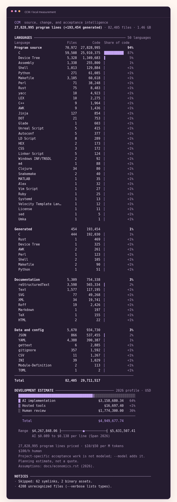

CCM
===

**Measure the code. Understand the change.**

`Download <https://github.com/insanai/ccm/releases/tag/v1.0.0-beta.1>`_ | `Website <https://insanai.github.io/ccm/>`_ | `The book <https://insanai.github.io/ccm/book/>`_ | `PDF <https://insanai.github.io/ccm/books/ccm-book-en.pdf>`_ | `Design <https://insanai.github.io/ccm/decisions/>`_

.. image:: https://img.shields.io/badge/release-1.0.0--beta.1-7341aa
   :alt: Release 1.0.0-beta.1
   :target: https://github.com/insanai/ccm/releases/tag/v1.0.0-beta.1

.. image:: https://github.com/insanai/ccm/actions/workflows/ci.yml/badge.svg
   :alt: Build and test status
   :target: https://github.com/insanai/ccm/actions/workflows/ci.yml

.. image:: https://img.shields.io/badge/license-LGPL--3.0--or--later-ee77ad
   :alt: LGPL 3.0 or later
   :target: COPYING.LESSER

CCM, the Code Counter Machine, is a fast command-line tool that measures source code, analyzes the impact of software changes, and estimates the AI, tool, and human resources needed to deliver them.

At its simplest, CCM gives us an instant, accurate inventory of a codebase: programming languages, file counts, lines of code, comments, and blank lines.
When we are planning or reviewing a change, CCM goes beyond simple line counting to answer three practical questions for developers and engineering leaders:

* **What did this change touch?** Compare two snapshots of a project and trace how edits in one file ripple through dependent components.
* **What still needs testing or review?** See which existing test results and reviews remain valid for unchanged parts of the system, and which checks must be re-run before release.
* **What will the work cost?** Estimate a transparent resource budget broken down across AI coding agents, hosted development sessions, human code review, and remaining verification work.

Every run produces the same underlying analysis at the level of detail we need: a clean terminal summary for daily development, a standalone HTML report for team and stakeholder reviews, and structured JSON, NDJSON, or CSV output for CI pipelines, dashboards, and AI agents.

CCM is written in Rust and has **no external crate dependencies**.
It runs entirely on the local machine, never executes the code it scans, and never sends source code or telemetry to an external service.

Features
--------

* **Clear, readable reports:** Aligned terminal tables with grouped numbers, language percentages, automatic color coding, and a concise resource summary.
* **Shareable and machine-readable outputs:** Standalone HTML reports for meetings and audits, plus JSON, NDJSON, and CSV formats for automation and AI agents.
* **Broad language coverage:** 64 built-in lexical scanners and a catalog of 658 language names, file formats, and aliases, covering the language names and extensions used by ``cloc``, ``scc``, and SLOC tools.
* **Accurate handling of mixed files:** Explicit counting rules for UI components, documentation markup, fenced code blocks in Markdown, strings, nested comments, and embedded languages such as scripts and styles inside HTML.
* **Predictable file selection:** Respects scoped ignore files (such as ``.gitignore``), filters out generated files, supports file-extension overrides, and enforces explicit limits on memory, file size, and worker threads.
* **Change impact analysis:** Exact byte-level file comparisons between two snapshots, paired with an optional dependency model that traces paths from modified files to affected downstream components.
* **Verification and test reuse:** Tracks which checks are invalidated by a change, which previous test or review results still hold, and when combining two changes triggers shared or additional integration checks.
* **Transparent 2026 cost modeling:** Separates AI implementation tokens, hosted sandbox sessions, human review hours, and remaining verification work using an editable 2026 research profile.
* **Portable, zero-setup executables:** Prebuilt native binaries for Linux, Windows, macOS, and FreeBSD, packaged with license texts, source commit provenance, and SHA-256 checksums.

The 658 entries in the language catalog include file formats and aliases mapped to shared counting rules; CCM does not claim 658 full compilers.
`The counting policies <docs/language-catalog.rst>`_ explain how the native scanners and declarative rules classify every line.

A real source tree
------------------

Above is the actual terminal output from running CCM on the Linux 6.12 kernel source tree, as shown on the project website.
In that recorded run, CCM scanned 82,405 files and classified 27,828,995 lines of program code (1.46 GB of source text) in about two seconds on the test machine.
These figures are recorded measurements of that specific snapshot and hardware, not a universal speed guarantee for every repository.
Similarly, the dollar amount shown at the bottom is a theoretical "rebuild from scratch" planning scenario under default assumptions, not the Linux project's historical development bill or market value.
The `measurement record <docs/performance.rst>`_ documents the hardware, methodology, and verification checks behind the benchmark.

Download and run
----------------

On macOS and Linux, the quickest way to install CCM is through the `CCM Homebrew tap <https://github.com/insanai/homebrew-ccm>`_:

.. code-block:: sh

   brew tap insanai/ccm
   brew install insanai/ccm/ccm
   ccm .

The tap tracks published releases (including betas) and installs the matching x86-64 or ARM64 binary after verifying its SHA-256 checksum.
An automated workflow checks for new releases every hour and can also be triggered on demand.

We can also download prebuilt archives and the PDF book directly from `Release 1.0.0-beta.1 <https://github.com/insanai/ccm/releases/tag/v1.0.0-beta.1>`_.

.. list-table:: Release executables
   :header-rows: 1
   :widths: 25 42 33

   * - Platform
     - Archive
     - Build target
   * - Linux x86-64
     - ``ccm-linux-amd64.tar.gz``
     - Static musl
   * - Linux ARM64
     - ``ccm-linux-arm64.tar.gz``
     - Static musl
   * - macOS Apple Silicon
     - ``ccm-macos-arm64.tar.gz``
     - macOS 12 or later
   * - macOS Intel
     - ``ccm-macos-amd64.tar.gz``
     - macOS 12 or later
   * - Windows x86-64
     - ``ccm-windows-amd64.zip``
     - Windows 10 or later; static MSVC runtime
   * - FreeBSD x86-64
     - ``ccm-freebsd-amd64.tar.gz``
     - FreeBSD 15.1

This is a beta release, and the macOS executables are currently unsigned.
Each archive contains the ``ccm`` binary, license texts, third-party notices, and a build manifest recording the exact source commit and compiler used.
The ``SHA256SUMS`` file covers all six platform archives and the PDF book.

For example, to download, verify, and run CCM on Linux x86-64:

.. code-block:: sh

   curl -fLO https://github.com/insanai/ccm/releases/download/v1.0.0-beta.1/ccm-linux-amd64.tar.gz
   curl -fLO https://github.com/insanai/ccm/releases/download/v1.0.0-beta.1/SHA256SUMS
   sha256sum --ignore-missing -c SHA256SUMS
   tar -xzf ccm-linux-amd64.tar.gz
   ./ccm-linux-amd64/ccm .

On macOS or FreeBSD, extract the matching ``tar.gz`` archive and run its ``ccm`` binary.
On Windows, extract the ZIP archive and run ``.\ccm-windows-amd64\ccm.exe .`` in PowerShell.
We can place the binary on ``PATH`` for everyday use; no server, database, or language runtime is required.

A few useful commands
----------------------

.. code-block:: sh

   ccm .                                    # Count the current directory and show a summary
   ccm . --no-cost                          # Count code only, omitting the cost estimate
   ccm . --color=always                     # Force colored output for pagers or CI logs
   ccm . --by-file --sort code              # Break down results by file, sorted by code lines
   ccm . --html -o report.html              # Save a standalone HTML report for sharing
   ccm . --json -o report.json              # Save the full structured report as JSON
   ccm . --format=csv --include-ext=rs,py   # Export CSV restricted to Rust and Python files
   ccm . --compare ../before --technical    # Compare two snapshots and show full equations

Color output is automatic on supported terminals, can be disabled by setting a nonempty ``NO_COLOR`` environment variable, or can be forced explicitly with ``--color=always``.
Running ``ccm --help`` lists all file selection, reporting, cost override, and resource limit options.
Rather than silently guessing or inventing numbers, CCM explicitly reports unknown file types and any files skipped due to configured limits.

Why a different cost method?
-----------------------------

Many source-code counters end their output with a single dollar estimate based on an uncalibrated 1980s or 1990s formula such as basic COCOMO.
That approach converts raw line counts directly into human person-months, which is a poor default for modern AI-assisted software development:

* **Line counts alone hide context:** 1,000 lines of fresh core logic, 1,000 lines of AI-generated boilerplate, a reused library, and a small patch to a critical module all carry very different costs and risks.
* **AI and tooling costs are missing:** Traditional size-to-labor formulas do not account for AI model token spend, hosted coding sandboxes, existing automated test coverage, or the human effort required to review and verify AI-assisted changes.

Full `COCOMO II <https://boehmcsse.org/tools/cocomo-ii/>`_ remains a serious estimation model when an organization calibrates its cost drivers to local historical project data.
Our objection is to presenting a code counter's default, uncalibrated line-count formula as a meaningful present-day development budget.
Instead, CCM separates **what work a change requires** from **how that work is priced**:

.. code-block:: text

   declared change -> affected parts -> required checks -> reusable evidence
   source workload + remaining checks -> AI, tool, and human resources -> cost

CCM computes its estimates in two distinct steps:

1. **Impact and verification calculation (the finite change model):** From a declared dependency and verification model, CCM calculates which parts of the system a change affects, which verification checks are triggered, and which checks remain pending after reusing valid test or review evidence from unchanged components.
2. **Activity-based resource pricing (the economic adapter):** CCM prices each activity separately (AI implementation tokens, hosted sandbox sessions, human code review, and the remaining verification checks) and then applies an explicit rework rate for changes that require multiple passes.

When we scan a repository without a task or change model, CCM still prices a baseline "AI rebuild" scenario for the code while leaving project-specific verification work marked as unknown.

The default 2026 cost profile combines published 2026 engineering research priors, inferred input/output token workloads, provisional language multipliers, reference model and sandbox prices, and explicit hourly assumptions for human engineering time.
These figures are transparent R&D planning assumptions, not live billing telemetry or a guaranteed price quote.
We can inspect the complete calculation with ``--technical`` and customize any rate or assumption with ``--cost-profile`` or command-line flags.
The `economic model <docs/economics.rst>`_ and `the CCM book <https://insanai.github.io/ccm/book/chapters/economics.html>`_ explain the exact equations, research sources, and how to calibrate the model to a team's own data.

A change we can explain
------------------------

.. code-block:: sh

   ccm examples/book/after --compare examples/book/before \
       --model examples/book/checkout.ccm --technical

The repository includes a complete example of an e-commerce checkout service (``pricing.rs``, ``inventory.rs``, ``checkout.rs``, and ``payment.rs``) before and after a change.
In this example, edits to pricing and inventory ripple through ``checkout.rs``, reaching **three affected parts** while leaving ``payment.rs`` untouched.
Based on the rules in ``examples/book/checkout.ccm``, those edits trigger **seven weighted units of verification work** across unit tests, compatibility checks, a joint checkout integration test (needed only when pricing and inventory change together), and a payment boundary review.
Because the payment module did not change, CCM reuses the existing accepted review for the payment boundary, leaving **six check units pending**.
Combining AI implementation, hosted tool sessions, human review of the affected files, and those six remaining verification units produces a default budget scenario of **675.86 USD**.
In the technical report, we can inspect why each check was triggered and which earlier review result still covers the unchanged payment boundary.
Only a previously passed test or accepted review can satisfy a required check; a recorded test failure identifies a defect and never counts as acceptance.

Today, the dependency and verification model is declared explicitly by the author in a ``.ccm`` file, and CCM analyzes that model without executing the project's test suite.
Automatic semantic dependency extraction from source code, cryptographically signed test certificates, live billing ledgers, and empirical labor calibration remain ongoing research work.

Build and contribute
---------------------

Building CCM from source requires Rust 1.85 or later.
Our release workflows build with Rust 1.98.1 and continuously test the minimum supported Rust version.

.. code-block:: sh

   git clone https://github.com/insanai/ccm.git
   cd ccm
   cargo build --release --locked -p ccm
   ./target/release/ccm .
   cargo install --path cmd/ccm --locked --offline

The workspace separates pure calculation from file-system scanning and CLI formatting:

* ``crates/ccm-core`` contains the pure mathematical kernel for metrics, change impact, verification rules, and cost modeling, and does not read files from disk.
* ``crates/ccm-scan`` and ``crates/ccm-project`` provide language counting rules, file selection, ignore handling, and bounded parallel scanning.
* ``cmd/ccm`` implements the command-line executable and report output formats.
* ``tools/`` contains internal Rust programs for release packaging, benchmarks, artwork generation, and repository checks.

`CONTRIBUTING.rst <CONTRIBUTING.rst>`_ describes the required verification checks and our local Jujutsu (``jj``) workflow.
`RELEASING.rst <RELEASING.rst>`_ explains native builds, archive verification, and release publication.
GitHub issue forms are available for bug reports and research proposals, and pull requests include a structured review template.

Documentation
-------------

* `Website <https://insanai.github.io/ccm/>`_: Project overview, Linux benchmark capture, and downloads.
* `The CCM book <https://insanai.github.io/ccm/book/>`_: In-depth guide to the counting algorithms, system architecture, mathematical model, cost estimation, and research roadmap.
* `PDF book <https://insanai.github.io/ccm/books/ccm-book-en.pdf>`_: The complete book typeset as a print-ready PDF edition.
* `Design records <https://insanai.github.io/ccm/decisions/>`_: Architectural decisions and formal research specifications.
* Reference guides for `language counting policies <docs/language-catalog.rst>`_, `file selection <docs/counting.rst>`_, and `machine report schemas <docs/reports.rst>`_.

Guidedog builds the complete website and PDF book directly from the committed documentation sources:

.. code-block:: sh

   guidedog ssg build docs --out docs/_build/site

Our GitHub Pages workflow runs this same command using Guidedog's embedded PDF compiler.
The Typst CLI is only needed when regenerating SVG diagrams and PNG previews via ``cargo xtask assets``.
The benchmark showcase reports for Linux, FreeBSD, and Chromium are committed snapshots, so building the documentation never downloads or rescans those repositories.

Authors and license
--------------------

Vikrant Rathore created CCM, with assistance from Ronak Rathore and Kanak Rathore.
CCM is free software distributed under the **LGPL 3.0 or later** license.
See ``COPYING.LESSER`` and ``COPYING`` for the full license text, and ``NOTICE`` for attribution of bundled materials.
Complete source code and Rust build tools are published at every release tag.
Language catalog metadata retains its original MIT license notice, which can also be viewed by running ``ccm --licenses``.
Organizations interested in alternative commercial licensing terms can contact `Vikrant Rathore <mailto:admin@vyomtech.com>`_.
All third-party materials retain their respective licenses.
