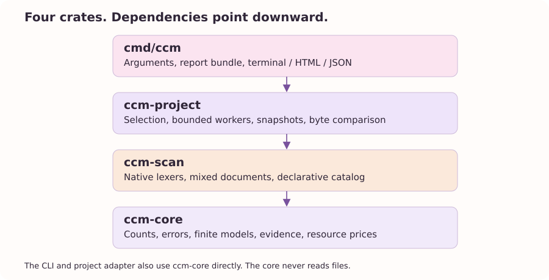
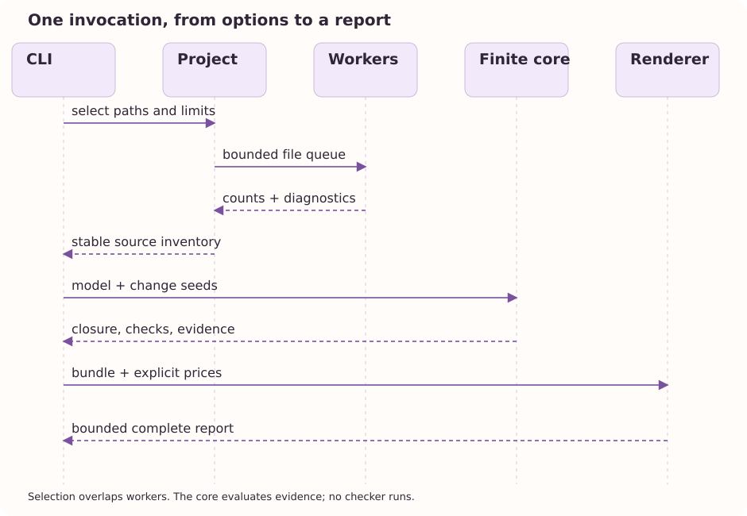

The shape of the machine
=========================

A command-line application is easier to reason about when its core can be used without a terminal.
CCM's workspace follows that rule.
The finite mathematics lives in a library that does not read files or print reports.
Filesystem policy and presentation surround it as separate adapters.

   Compile-time dependencies point toward a smaller, filesystem-independent core.

``ccm-core`` owns counts, structured errors, finite models, behavioral cases, and resource-price equations.
Its functions borrow declared inputs and return owned results or diagnostics.
This boundary lets a unit test evaluate a three-artifact graph without creating a checkout or redirecting stdout.
It also lets another application reuse the finite evaluator without adopting CCM's CLI vocabulary.

``ccm-scan`` turns bounded UTF-8 input into physical counts under a selected language policy.
It knows lexical states and mixed-file boundaries.
It does not decide which repository paths should be selected, which artifacts depend on one another, or how many dollars an activity should cost.

``ccm-project`` owns those filesystem observations that a scanner should not make.
It walks paths, applies ignore rules, feeds bounded workers, detects generated headers, retains stable file identities, and compares snapshots.
It returns a report containing data and notices rather than printing them.
The application can therefore render the same observation as terminal text, HTML, or JSON.

``cmd/ccm`` parses options, assembles the current and optional baseline inventory, loads a declared model, maps seeds, asks the core for results, applies explicit economic assumptions, and renders one bounded report.
A bundle holds these observations together.
The bundle does not erase the distinction between an absent task model and a model whose pending work is zero.

The order of one invocation
---------------------------

   The high-level call sequence.
   Worker execution overlaps selection, while model evaluation follows the completed inventory.

The application validates assumptions before expensive filesystem work.
Selection and lexical workers then overlap through a bounded queue.
The project adapter collects results and sorts them into a stable report.
If a baseline was requested, byte comparison determines changed file identities.
If a task model was requested, parsing and validation precede finite evaluation.
Pricing and rendering come after these inputs have explicit status.

The renderer receives a complete bundle rather than asking the filesystem questions of its own.
This keeps format changes from becoming measurement changes.
HTML branding, a table's spacing, and a JSON field can evolve without changing the graph closure algorithm.
The output writer receives a completed string only after the rendering budget has been respected.

Few dependencies, explicit tools
--------------------------------

The runtime workspace uses the Rust standard library and its own small modules.
It has no external crate dependencies.
This choice is useful for distribution, auditability, startup, and controlling the amount of code needed to understand a result.
It does not require reimplementing a full compiler for every language.
The policy tiers expose where generic definitions end and specialized handling begins.

The book and artwork are development tools, not runtime services.
``ccm-art`` emits deterministic SVG with a small standard-library writer.
The documentation task invokes Guidedog, Typst, and Chromium to build the website, typeset the PDF, and capture live screenshots.
CeTZ and Fletcher draw the book's monochrome cover illustration.
Those tools are not launched when a developer runs ``ccm`` against a source tree.

A future tree-sitter or compiler adapter should preserve the same direction of dependence.
It can supply richer typed edges, source bindings, or checked evidence to the core.
It should not make the core depend on a network service or a human report format.
The architecture's value is the boundary it preserves as the sources of evidence become richer.
