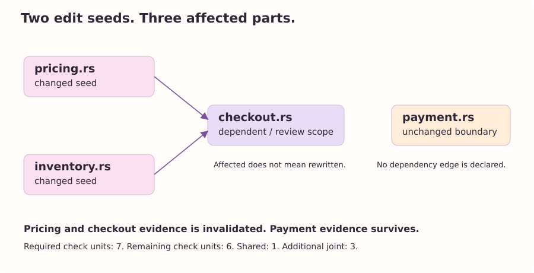

From two snapshots to a task
============================

A snapshot tells us what is present.
A comparison tells us which selected files have different bytes.
Neither statement yet tells us why a change is being made.
The task model supplies that missing context.

Our checkout example changes two values.
The pricing function returns 100 before the edit and 110 afterward.
The inventory function returns 10 before the edit and 9 afterward.
The checkout and payment source files retain their bytes.

.. code-block:: sh

   ccm --compare examples/book/before examples/book/after

CCM reports modified pricing and inventory files.
It also distinguishes added and removed files.
A comment-only edit is still a byte change, even if it leaves program behavior untouched.
This is deliberate: the snapshot comparison is an exact file-byte operation, not a semantic equivalence test.

What comparison actually does
------------------------------

The project adapter first measures both snapshots under the same selected options.
It matches root-relative file identities and compares the retained files' bytes, with bounded reads and mutation checks.
Equal line counts are insufficient to establish equal contents.
Two files can have the same number of code lines while implementing different functions.

The comparison retains before and after counts alongside its file status.
It does not compute a general patch algebra or estimate the implementation effort of individual changed statements.
In the current economic adapter, a comparison selects whole changed source files in the current snapshot for the rebuild scenario.
A removed file has no current implementation lines, but it can still contribute review work.
This scope is conservative about what a file-level observation can justify.

The model's edge direction
--------------------------

We now declare that checkout depends on pricing and inventory.
The graph records the direction in which invalidation travels: an assumption points to its dependent.
A pricing edit therefore reaches checkout.
A checkout edit does not automatically reach pricing through the same edge.

   The declared dependency model for the running example.
   The payment part has no dependency edge in this model.

This graph is supplied by the model author.
The lexical language registry does not extract it.
Broad counting support and automatic semantic dependency extraction are separate engineering problems.
Tree-sitter, code property graphs, compiler data, and patches can become future adapters, but a source counter does not obtain their guarantees merely by recognizing an extension.

A task is more than a changed set
---------------------------------

The model also declares required checks and the evidence already available.
A pricing edit activates a pricing contract check.
An inventory edit activates stock availability.
Either edit activates checkout compatibility.
Their combination activates an additional combined checkout test.
A payment boundary review is standing work, active even with no edit seeds.

The model's context identity binds these declarations to a task, source snapshot, environment, and policy by author assertion.
The identity is required, but the current executable does not authenticate it or cryptographically bind it to source bytes.
A precise string is a useful discipline; it is not a substitute for a provenance mechanism.

We can let comparison paths supply the seeds when those paths match declared artifacts.
We can also supply explicit seeds with repeated ``--changed`` options.
Explicit names are particularly useful when artifacts represent interfaces or environmental assumptions rather than files.
An abstract artifact can participate in exact finite reasoning while remaining unmapped to an implementation line count.
The estimate must then preserve the unpriced scope.

The next chapter makes these declarations executable.
The result will explain three different sets: the files whose bytes changed, the parts reached by invalidation, and the checks that remain open.
Keeping those sets distinct is the first step toward an intelligible change report.
