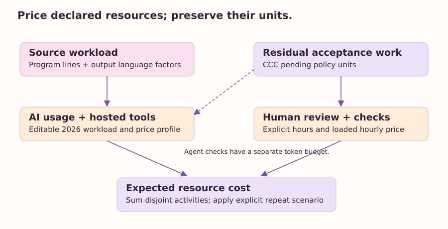

From quantities to an economic scenario
=======================================

A measured source tree is not an invoice.
A required check is not an hour.
A distinction bit is not a dollar.
To obtain a development scenario we must declare resource quantities and the prices attached to them.
The theory gives a disciplined place for those declarations, while empirical work must determine how well they predict a particular task.

The current adapter separates implementation, additional agent acceptance work, hosted sessions, human activities, and optional extra spending.
Implementation quantities attach to selected source files or matched change seeds.
Human review attaches to the affected closure when a model is supplied.
Additional check activity attaches to pending policy units after evidence transport.
These choices preserve the calculus's separation between a description of change, its propagated effects, and its remaining assurance demand.

   The economic adapter prices declared activities after the finite calculations.
   It does not convert semantic information directly into money.

A source-based AI workload
---------------------------

Let :math:`L_l` be selected nongenerated program lines in language :math:`l`.
Let :math:`f_l` be that language's output-workload factor and :math:`m` a user-supplied workload multiplier.
The profile supplies inferred input and output tokens per reference program line, :math:`t_I` and :math:`t_O`.
We calculate implementation token equivalents as:

.. math::

   I=m t_I\sum_l L_l,\qquad
   O=m t_O\sum_l f_l L_l.

Only the output quantity receives the language adjustment in this profile.
Unmeasured languages have a neutral factor of one.
The factor is an explicit transferred prior, not a compiler-derived measure of semantic difficulty.
We will examine its 2026 evidence in the next chapter.

With input and output prices :math:`p_I` and :math:`p_O` in USD per million tokens, the implementation scenario is:

.. math::

   C_{\mathrm{implementation}}=(p_I I+p_O O)/10^6.

The prior includes generic exploration, iteration, and verification by an agent.
We must not add another default iteration multiplier for the same activity.
Project-specific acceptance beyond that generic work has a separate explicit budget.

Residual checks and hosted tools
--------------------------------

Let U be pending policy units and b an assumed token budget per unit.
The default is 1,000 additional agent tokens per pending unit.
Let s be the input share implied by the two per-line token coefficients, using 0.9 when both coefficients are zero.
The additional agent acceptance scenario is:

.. math::

   C_{\mathrm{checks}}=m b U\{s p_I+(1-s)p_O\}/10^6.

The coefficient b is an R&D guess.
A policy unit is not intrinsically a duration or a token quantity.
If the implementation prior already includes these specific checks, we can set b to zero rather than charge twice.
Human check hours represent separate human work; fully automated checks can have zero human hours in a locally calibrated scenario.

Hosted tools use a second declared throughput assumption.
The default assumes one 1 GB, twenty-minute sandbox session per fifty delivered program lines, rounding the selected scope upward to whole sessions.
It prices each session at 0.03 USD in the frozen card.
This throughput is a guess, not an observed average from the development study.
A zero-line scope incurs no default session charge even when declared check work remains.
Additional CI, sandbox use for checks, hardware, storage, search services, deployment, and subscription allocations are excluded unless explicitly budgeted.
There is no invented fee for each local tool call.

Human work and an optional repeat scenario
------------------------------------------

Human hours add review hours per affected part, check hours per pending unit, and explicitly supplied implementation hours.
The loaded hourly price can represent resource and opportunity cost rather than only salary.
The default per-file or per-artifact review assumption is sensitive to granularity and is not a fitted labor model.
Splitting one module into ten files can change this assumption without changing functionality.

Let :math:`H` be those human hours, :math:`p_H` their loaded price, :math:`A` explicit extra AI/tool spending, :math:`S` the assumed hosted sessions, and :math:`p_S` their session price.
An optional stationary repeat probability r gives:

.. math::

   C=\frac{p_HH+A+C_{\mathrm{implementation}}+C_{\mathrm{checks}}+p_SS}{1-r}.

The geometric multiplier assumes comparable repeated attempts with a stationary independent repeat probability.
A real attempt can change the task, evidence, environment, or agent strategy, so this is a scenario rather than a universal process law.
The CLI accepts r from zero through 0.95 and defaults to zero additional repetition.

The default and HTML breakdowns multiply every displayed component by the same expected-attempt factor as the total.
Machine output also retains per-attempt quantities.
Money is calculated with finite floating-point inputs and displayed to cents; it is not exact rational accounting.

Overrides and interpretation
-----------------------------

``--agent-cost`` replaces all automatic AI and hosted-tool spending for one attempt.
``--implementation-hours`` adds explicit human implementation work.
``--cost-profile`` changes token coefficients, prices, session assumptions, workload, year, model label, and registered language factors in argument order.
Prices and resource assumptions remain independent inputs.

The resulting number is a resource-cost scenario for a stated scope.
It does not estimate market value, willingness to pay, a delivery date, or the number of people required.
A richer schedule or staffing model would need capacity, dependencies between activities, delays, and empirical service-time information.
We keep those missing quantities visible instead of deriving them from source size by convention.
