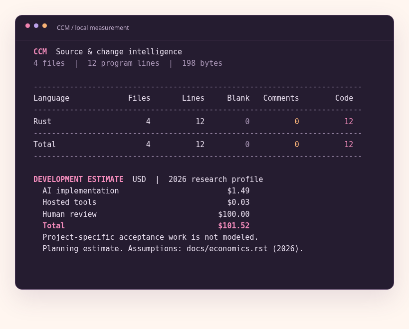

A first measurement
====================

The first useful run should answer a familiar question: what is in this source tree?
We should not need to learn a theory before reading that answer.
CCM therefore begins with Language, Files, Lines, Blank, Comments, and Code.
The table uses ordinary names and grouped numbers.
Color reinforces those names when stdout is a color terminal.

We build the release executable before comparing speed with another tool.
A Cargo development build serves debugging and iteration; its runtime is not the release-performance claim.
For a local installation we can let Cargo place the optimized executable on the path.

.. code-block:: sh

   cargo build --release
   cargo install --path cmd/ccm --offline
   ccm examples/book/after

The fixture contains four Rust files.
Each has three physical code lines, so the inventory has twelve program lines.
The program does not execute those files.
It reads their bytes, applies the selected lexical policy, and assembles a report.

   The executable's output, captured with the book's terminal palette.
   The screenshot is generated from the checked-in fixture rather than drawn as an illustrative result.

The inventory before the estimate
---------------------------------

Lines is the physical total under the policy's line-ending rules.
Code, comment-only, and blank form a disjoint partition of that total.
A line containing both an expression and a trailing comment belongs to Code.
The Code column also follows the established counter convention for documentation and data: it contains their noncomment content.
The language row supplies the context needed to interpret that convention.

Program lines is a narrower aggregate.
It selects policies classified as program source and leaves documentation and data outside that total.
The AI implementation scenario narrows the scope again by excluding recognized generated files.
These quantities need not be equal, and a difference is not an arithmetic failure.
We will keep their selection rules visible as the example grows.

A normal skip is different from a failed measurement.
A binary image, a symlink, or an explicitly excluded directory does not require a warning for each path.
An unreadable input, an invalid task model, or a resource limit needs a diagnostic.
A detected lexical coverage failure produces an incomplete report and exit status 2.
This distinction lets the useful table remain readable while preserving failures for automation.

The short estimate
-------------------

Below the inventory we see a compact development scenario.
It separates AI implementation, hosted tools, human review, and any additional modeled activities.
Zero optional activities do not occupy rows in the ordinary report.
Unknown project-specific acceptance work is described as unmodeled rather than priced as a known zero.
The assumptions reference points to the economic account instead of reproducing a research essay in the terminal.

The default figure estimates a counterfactual rebuild of selected, nongenerated program source with an AI coding agent.
It is not a reconstruction of the repository's historical spending.
It is not the purchase price or asset value of the software.
The human review component uses an explicit per-file assumption, and the agent component uses the editable 2026 profile.
We will derive both quantities later.

For a counting-only view, we remove the scenario.
For a compact price and coverage explanation, we request verbose output.
For the full expert account, we request the technical report.

.. code-block:: sh

   ccm --no-cost examples/book/after
   ccm --verbose examples/book/after
   ccm --technical examples/book/after

Formats belong to their readers
-------------------------------

The terminal report is for a person making a quick inspection.
HTML carries the same measured bundle into a standalone document with collapsible assumptions and no runtime scripts or remote assets.
JSON preserves numeric components, unknown scope, policy identifiers, and model results for agents.
CSV and NDJSON serve tabular and record-oriented consumers.
We do not ask an agent to recover structured facts by scraping the human table.

.. code-block:: sh

   ccm examples/book/after --html -o report.html
   ccm examples/book/after --json -o report.json
   ccm examples/book/after --format csv -o files.csv

Existing output files are protected unless we supply ``--force``.
Forced replacement uses the output writer's atomic replacement path rather than truncating the previous report before rendering succeeds.
A rendering budget also bounds the complete report before publication.

A color terminal normally receives color automatically.
A pipe normally receives plain text.
A nonempty NO_COLOR variable disables automatic color, and ``--color=always`` is the explicit override.
The labels retain their meaning in monochrome, in a narrow terminal, and in a PDF screenshot.
Color is a reading aid, not an additional data channel.
