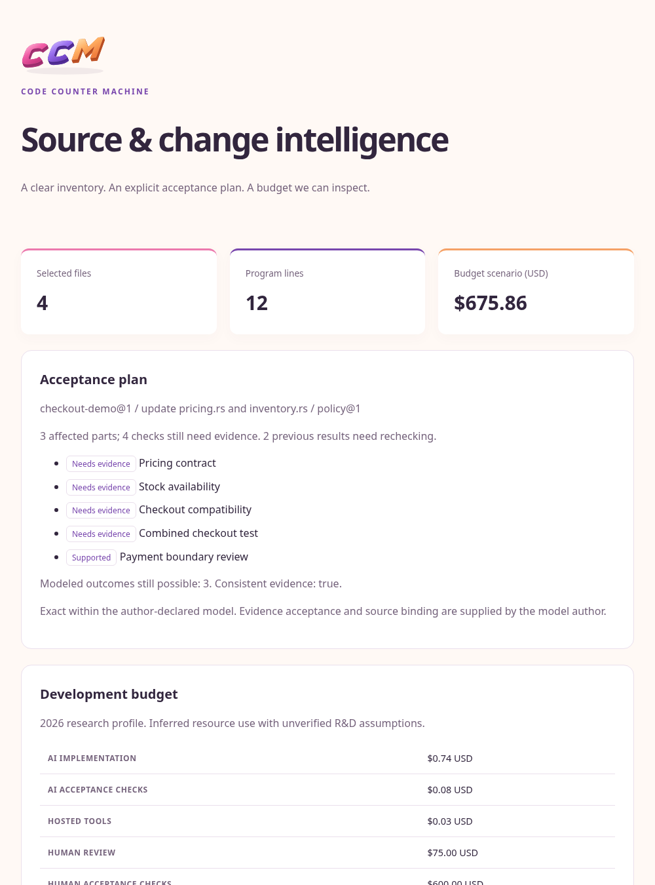

A report, a book, and a visual identity
========================================

A measurement is only useful after someone can read it.
CCM's interface therefore treats presentation as an explanation of the bundle rather than a second analysis engine.
The same inventory, finite model, and economic inputs can produce a short terminal view, an expert view, a standalone report, or a machine record.
Their different levels of detail should not produce different quantities.

The normal terminal table keeps the word Code.
Its labels carry the meaning in monochrome, while pink, purple, and orange accents help a color terminal separate structure and quantities.
The compact estimate omits zero optional activities and points to the assumptions.
Technical output supplies the full derivation when that detail is the purpose of the invocation.
This balance lets a planning reader find the result without losing the expert's audit trail.

   The live HTML report for the running example.
   Its logo is an embedded SVG; the document does not require a network asset or script to display.

One logo, several media
-----------------------

The three-dimensional mark is generated by the Rust tool ``ccm-art``.
Its C, C, and M contours are explicit vector paths.
An affine projection sets the viewing plane, offset layers create the apparent extrusion, and front-face gradients distinguish pink, purple, and orange materials.
The effect is a reproducible vector drawing with a fixed view, not an external 3D runtime.
A monochrome outline variant accompanies it.

The same canonical SVG is embedded in standalone reports and staged into the book and website.
We do not maintain an unrelated hand-edited mark for each surface.
Regenerating the asset therefore changes the visible identity through one reviewed source tool.
The tool uses the standard library's formatting and filesystem support, with no external Rust SVG crate.

The book cover has another job.
Its notebook, dependency drawing, check, pencil, offset strokes, and restrained hatching form a simple black-and-white illustration that remains legible on paper.
The custom Typst template uses CeTZ 0.3.4 and Fletcher 0.5.8 for this drawing.
The versions are pinned together for the document build.
The colored logo remains small on the cover; the illustration itself uses only black and gray strokes.

The publication pipeline
-------------------------

.. code-block:: sh

   guidedog ssg build docs --out docs/_build/site
   guidedog build pdf docs/book

When we edit generated artwork or the executable screenshots, we refresh those inputs and ask the same installed Guidedog CLI to assemble the result.

.. code-block:: sh

   cargo xtask assets
   cargo xtask docs
   cargo xtask docs --no-pdf

The complete task regenerates vector assets, renders the cover preview, stages shared files, builds CCM, captures live report screenshots, and asks Guidedog to assemble the landing page, HTML book, PDF book, and design-record catalog.
The build invokes the installed ``guidedog`` executable on PATH; ``--guidedog PATH`` selects another installed executable.
Guidedog generates the PDF through its normal compiler support; the book configuration does not override it with an external executable.
The separate Typst CLI is needed only for SVG artwork and PNG previews, while Chromium captures the report screenshots.
``cargo xtask assets`` checks for the Typst CLI first and reports an Elm-style error with an installation hint if it is missing.
We can still build the book through Guidedog from the prepared assets.
These are publication tools, not dependencies invoked by ordinary measurement.

The landing page introduces the same three questions as the book: what is present, what a declared change affects, and what evidence or resources remain necessary.
It links directly to the HTML book, downloadable PDF, examples, and design records.
The assembled site is a local artifact until we deliberately publish it.

Screenshots as observations
----------------------------

The CLI screenshots begin with actual ANSI output from the executable.
A small renderer displays that transcript in the book's terminal palette, and Chromium captures the result.
The report screenshot begins with CCM's own HTML output for the same fixture.
Neither image is a manually invented table.
The generated JSON beside them makes the quantities independently inspectable.

The fixture and its source model keep screenshots from becoming ornamental examples that no longer match the software.
We can regenerate them after a CLI change, inspect overflow and contrast, and compare the underlying numeric result.
A useful screenshot is another reproducible view of a measurement.

The last design rule
---------------------

A beautiful interface does not need an unexplained score.
It needs hierarchy, readable names, stable units, and a visible route to detail.
The prose, diagrams, and artwork in this book follow the same rule as the executable: a claim should have a place where its inputs and limits can be found.
