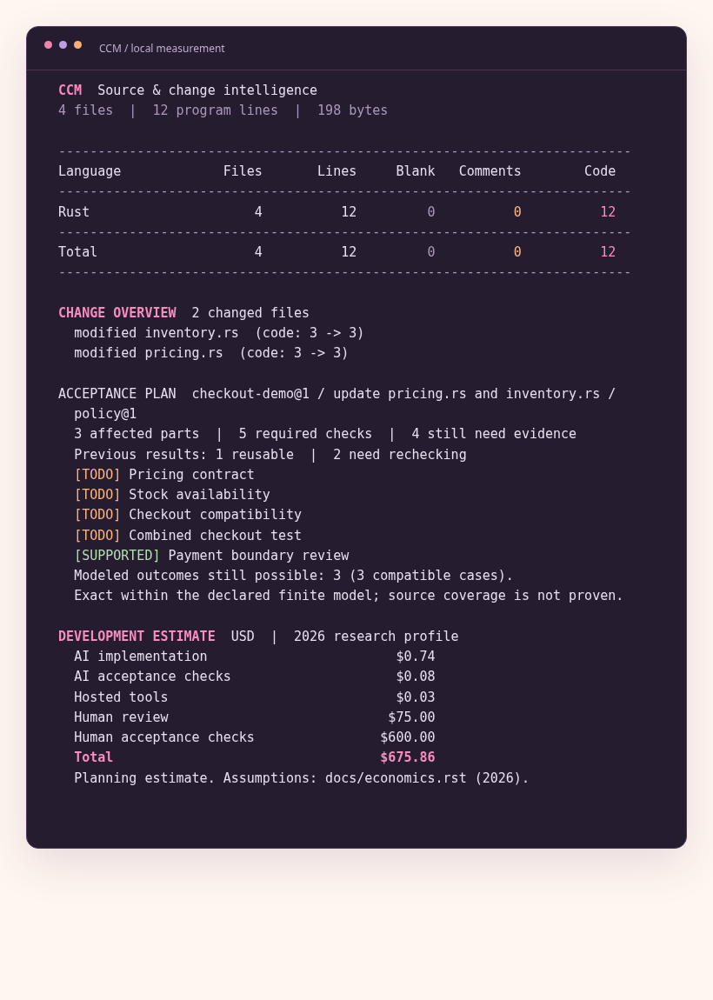

A checkout change, calculated
=============================

We now have enough context to write the task model.
The preferred format begins with ``ccm-model`` and version 2, separated by a literal tab.
Records use tab-separated fields; comments begin with ``#``.
Names must be declared before they are referenced.
The checked-in file is ``examples/book/checkout.ccm``.

Four artifacts name the source parts: pricing, inventory, checkout, and payment, with their ``.rs`` suffixes.
Two edges point from pricing and inventory to checkout.
The declarations deliberately omit a dependency edge to payment.
The payment boundary remains relevant through a standing check and surviving evidence rather than through reachability.

.. list-table:: Required checks in the example
   :header-rows: 1
   :widths: 42 13 45

   * - Check
     - Units
     - Activation
   * - Pricing contract
     - 1
     - Pricing is affected.
   * - Stock availability
     - 1
     - Inventory is affected.
   * - Checkout compatibility
     - 1
     - Pricing or inventory is affected.
   * - Combined checkout test
     - 3
     - Pricing and inventory are affected.
   * - Payment boundary review
     - 1
     - Always active.

Trigger syntax keeps alternatives and conjunctions explicit.
A comma joins members of one conjunction; a semicolon separates alternatives.
A dash denotes the empty conjunction, which is true and therefore activates standing work.
Weights are nonnegative policy units.
They do not become hours until an economic assumption supplies a conversion.

Running the complete example
-----------------------------

.. code-block:: sh

   ccm examples/book/after --compare examples/book/before \
       --model examples/book/checkout.ccm

   One change report connects file differences, affected parts, evidence, and resource assumptions.

The seeds are pricing and inventory.
Reachability includes each seed and their dependent checkout, producing three affected parts.
Payment is outside the closure.
All five checks activate, with total weight seven.

The previous pricing test depends on pricing, so it is invalidated.
The previous checkout test depends on checkout, so it is also invalidated.
The payment review depends only on payment and survives.
It supports the standing boundary check, leaving six policy units pending across four checks.
These are results of the declared finite model; no checker is executed by this invocation.

Shared and joint work
----------------------

A pricing-only batch activates the pricing, compatibility, and payment checks.
An inventory-only batch activates stock, compatibility, and payment.
The compatibility check is shared work.
The combined checkout test appears only for the union and contributes three additional joint units.
Standing payment work is removed from the interaction comparison.

The shared weight is one and the additional joint weight is three.
Their difference is two.
A positive net interaction here means the combined activation creates more joint work than it shares.
It is not a statement that batching is always undesirable, and it is not yet a monetary result.
Later we will derive the identity behind this calculation.

Behavior and evidence
---------------------

The example declares four hypotheses with four different observation labels: accepted checkout, wrong price, wrong stock, and payment timeout.
Each admitted evidence item supplies an explicit compatibility filter over those hypotheses.
After the edit, only payment evidence survives.
Its filter leaves three hypotheses and three distinct observations compatible.
The displayed distinction capacity is therefore approximately 1.585 bits.

Without changed seeds, all three accepted records survive.
Their filters intersect to one declared hypothesis and one observation, giving zero distinction bits within this finite universe.
That result is not a proof of arbitrary checkout correctness.
It is a statement about the hypotheses the author chose to enumerate.

Pricing the declared activities
-------------------------------

The review assumption is 0.25 hours for each affected artifact.
Three affected artifacts therefore contribute 0.75 review hours.
Six remaining policy units, at one human hour per unit, contribute six more hours.
At 100 USD per loaded hour, these human activities total 675 USD.

Implementation scope attaches to the two seed source files, which contain six program lines in total.
The 2026 profile prices their inferred Rust workload at about 0.74424 USD.
The additional agent check budget contributes 0.084 USD and one assumed hosted session contributes 0.03 USD.
With no additional repeat probability, the expected total is about 675.85824 USD, displayed as 675.86 USD.

The report rounds displayed components independently and rounds the total after summation.
A one-cent difference between the sum of displayed components and the displayed total can therefore occur.
The JSON report retains the underlying numeric components for reconciliation.
The quantities are useful because their origin is visible, not because the small example validates a general development forecast.
