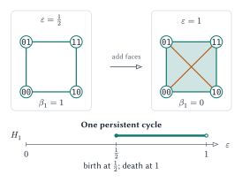
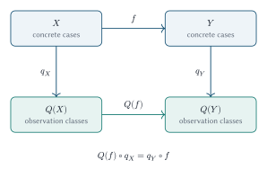
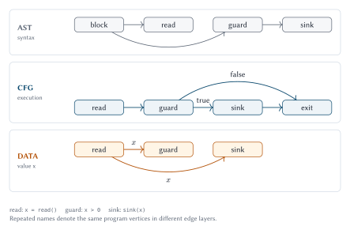

:cmd-number: 0002
:cmd-title: A change and certificate calculus for code measurement
:cmd-state: discussion
:cmd-type: Standards Track
:cmd-authors: ["Vikrant Rathore"]
:cmd-created: 2026-10-23
:cmd-updated: 2026-10-23
:cmd-discussion: Local repository review; no external discussion URL assigned
:cmd-labels: ["theory", "algorithms", "architecture", "ai-impact"]

.. _ccm-calculus:

A change and certificate calculus for code measurement
======================================================

Abstract
--------

We propose a Change and Certificate Calculus (CCC) for Code Counter Machine (CCM).
We measure the distinctions a task must preserve, the dependencies a change may invalidate, the obligations it activates, and the evidence that discharges those obligations.
We retain source counts as physical measurements and stop treating them as a universal model of difficulty or effort.
We define a vector with explicit units rather than an unexplained complexity score.
We derive closure, composition, evidence, interaction, and approximation laws, then specify bounded algorithms that compute particular instances.
We develop concrete candidates from persistent homology, algorithmic information, category theory, path entropy, typed code property graphs, and graph spectra.
We extend the calculus with evidence-conditioned behavioral ambiguity, signed evidence interaction, and persistence of unresolved distinctions across a verification budget.
We also propose a process model for human and agent work and a controlled method for measuring AI's impact.

This is a candidate theory and engine design, not a report of implemented results.
The mathematical results below follow from stated finite models.
Their usefulness for predicting review time, defects, or delivery performance remains an empirical hypothesis.
Our proposed contribution is the combined task-relative calculus, its evidence rules, its interaction accounting, and its bounded implementation contract.
We do not claim that graph reachability, partition lattices, information measures, Boolean inversion, or queueing theory are new mathematics.
We seek new software measurements through a precise construction on these foundations, with stronger theory developed where experiments expose a need.

Three questions and a reading map
---------------------------------

The central distinction is simple: describing a change, propagating its effects, and justifying its acceptance are different tasks.
A thousand repeated lines can be cheap to describe while invalidating many assumptions.
Two individually weak checks can jointly settle a property that neither settles alone.
These examples motivate the mathematics; they do not replace its definitions.

.. graphviz::
   :caption: Three complementary views of one proposed change. Each arrow names information the model needs, not an automatic semantic guarantee.
   :alt: A source change has a description cost, a dependency impact, and an assurance demand, which together inform process measurements.

   digraph overview {
     graph [rankdir=TB, bgcolor="transparent", nodesep=0.4, ranksep=0.6];
     node [shape=box, style="rounded,filled", fontname="Helvetica", margin="0.16,0.12"];
     edge [color="#64748b", fontname="Helvetica", fontsize=10];
     change [label="One task, two source snapshots", fillcolor="#eef4f8", color="#0c4a6e"];
     describe [label="DESCRIBE\nTokens, dictionary, delta bits", fillcolor="#eef4f8", color="#0c4a6e"];
     propagate [label="PROPAGATE\nTyped dependencies, boundaries", fillcolor="#fff5e6", color="#b45309"];
     assure [label="JUSTIFY\nObligations, surviving evidence, ambiguity", fillcolor="#e7f3f1", color="#0f766e"];
     process [label="Human work, agent cost, quality, delivery\nMeasured separately; causal claims need a design", fillcolor="#f3f7f8", color="#475569"];
     {rank=same; describe; propagate; assure;}
     change -> describe [label="canonical source"];
     change -> propagate [label="language model"];
     change -> assure [label="task and evidence"];
     describe -> process; propagate -> process; assure -> process;
   }

For a first reading we follow the candidate table, the worked finite examples, and the evidence-complementarity diagram.
For mathematical review we follow definitions, propositions, proofs, counterexamples, and the novelty ledger.
For engine review we follow the computational contracts, separator algorithm, and GuideDog benchmark gate.
No route changes the assumptions or acceptance criteria.

.. list-table:: Compact notation guide
   :header-rows: 1
   :widths: 20 53 27

   * - Symbol
     - Meaning
     - Unit or type
   * - :math:`\theta`
     - Snapshot, task, observer, extraction, and evidence context.
     - Versioned identity
   * - :math:`D(S)`
     - Artifacts reached from change seeds through invalidation edges.
     - Artifact set
   * - :math:`W(S)`, :math:`U(S,L)`
     - Activated obligation mass and the part without accepted evidence.
     - Policy units
   * - :math:`\kappa(q)`
     - Smallest modeled change that invalidates every evidence route for a standing obligation.
     - Artifact seeds
   * - :math:`\Omega_L`, :math:`g`
     - Evidence-compatible hypotheses and the task observation map.
     - Finite set; function
   * - :math:`H_A(L)`
     - Logarithm of surviving task-observation count.
     - Distinction bits
   * - :math:`\chi(e,f\mid L)`
     - Complementarity or overlap of two evidence items.
     - Distinction bits
   * - :math:`\mathcal{A}_B`
     - Area under unresolved ambiguity over a verification budget.
     - Bits times cost unit
   * - :math:`L_\Delta`, :math:`H_{\mathrm{path},h}`
     - Change-description length and bounded trace entropy.
     - Description bits; probability-weighted bits

The two kinds of bits refer to different experiments and are not automatically interchangeable.
We define each object fully before a proposition relies on it.

Problem, scope, and prior work
------------------------------

Counting answers how much source we have under a line classification policy.
Cyclomatic complexity describes a control-flow graph; cognitive complexity assigns syntactic penalties intended to reflect understandability [mccabe]_ [cognitive]_.
Neither alone specifies what a proposed change invalidates, what evidence is reusable, or how an agent changes the work needed to accept a task.
We preserve these measurements as baselines rather than declaring them universally invalid.

We inspect cloc, SLOCCount, and scc as predecessor tools [cloc]_ [sloccount]_ [scc]_.
The inspected scc documentation already includes unique lines, cognitive complexity, and LOCOMO estimates for LLM-related cost.
Adding an AI label, compression ratio, or nesting counter would therefore be an insufficient distinction.
We seek reproducible measurements of change and assurance, better predictive validation, and faster equivalent counting.

Static analysis is not inherently blind to time or state.
Abstract interpretation can approximate dynamic properties without executing the program [abstract]_.
Dependence graphs and program slicing already analyze impact [slicing]_.
Design structure matrices and propagation cost already study coupling [propagation]_.
Proof-carrying code already binds checked evidence to a safety policy [pcc]_.
Our calculus builds on these ideas; a literature review and independent review must test any stronger novelty claim.

We separate four activities: counting, extracting a finite model, measuring a specified change, and estimating a development process.
The default counter performs only the first.
A structural analysis can implement the finite calculus exactly without proving that its extracted graph captures all program behavior.
Semantic guarantees require a sound adapter for an explicitly supported language subset and observation policy.
We do not promise universal semantic equivalence, exhaustive execution, or a universal measure of intelligence or code quality.

Candidate foundations: constructions, not analogies
---------------------------------------------------

We keep the candidates in the research program rather than choosing a fashionable mathematical vocabulary first.
Each candidate below has a defined object, a computable quantity, a cost, and a falsifiable claim about usefulness.
We can combine complementary measurements without pretending they share one unit or guarantee.

.. list-table:: Which question does each foundation answer?
   :header-rows: 1
   :widths: 23 43 34

   * - Foundation
     - Well-defined question
     - What it cannot establish alone
   * - TDA and persistent homology
     - Which features of a chosen state-space geometry persist across scale?
     - That a hole is a bug or a race.
   * - Algorithmic information and compression
     - How short is a reproducible description under a specified code?
     - Intrinsic semantic difficulty or exact Kolmogorov complexity.
   * - Category theory
     - Does an observation abstraction respect a specified composition?
     - Correctness of a program merely because a mapping exists.
   * - Shannon path entropy
     - How uncertain are bounded execution observations under a declared distribution?
     - Worst-case safety or an input distribution inferred from syntax.
   * - CPG and spectral analysis
     - How do typed dependencies connect, cluster, and conduct influence?
     - Unique graph identity or a universal maintenance score.
   * - Evidence-conditioned behavior
     - Which task distinctions remain compatible with accepted evidence?
     - Completeness beyond the declared hypothesis universe.

TDA: define the space before interpreting its holes
~~~~~~~~~~~~~~~~~~~~~~~~~~~~~~~~~~~~~~~~~~~~~~~~~~~

Persistent homology is a serious candidate for a richer behavioral measurement, provided we state the geometry [persistence]_ [modules]_.
We propose two distinct constructions: a trace-state complex here and an evidence-elimination persistence object later.
They answer different questions and must not share an unlabeled "topology score".

For a trace-state experiment, take a finite set :math:`X` of recorded abstract states.
An explicit encoder maps each state to :math:`d>0` finite coordinates.
For a first reproducible experiment use normalized Hamming distance

.. math::

   d_X(x,y)=\frac{1}{d}\sum_{i=1}^{d}\mathbf{1}_{x_i\ne y_i}.

If distinct concrete states receive the same encoding, this is a pseudometric on concrete states and a metric on encoded states.
Coordinate choice and weighting are part of the measurement identity.
We do not assume the point cloud is a manifold, and we retain original temporal and happens-before edges separately.
An unordered cloud cannot recover event order.

At threshold :math:`\epsilon`, form a Vietoris-Rips complex: a finite set of vertices is a simplex when all its pairwise distances are at most :math:`\epsilon`.
For initial experiments we retain vertices, edges, and triangles, sufficient to compute :math:`H_0` and :math:`H_1`.
Over the field :math:`\mathbb{F}_2`, let :math:`\partial_k` be the boundary matrix taking a simplex to the sum of its faces.
Then

.. math::

   \beta_k=\dim\ker\partial_k-\operatorname{rank}\partial_{k+1},
   \qquad k\in\{0,1\}.

Every face of a simplex boundary occurs twice in its next boundary, so :math:`\partial_k\partial_{k+1}=0`.
The image is therefore contained in the kernel and the quotient homology is defined.
As the threshold grows, inclusion of complexes induces maps on homology; persistent intervals record the birth and death of classes under these maps.
Counting Betti numbers at isolated thresholds loses this correspondence.

   A controlled four-state filtration. The square cycle is born at one half and filled at one; the barcode records its lifetime.

For the four binary states, the one-dimensional barcode has the interval :math:`[1/2,1)`.
This is a topological statement about the encoded square, not evidence of a vulnerability.
All four triangle faces are included in the right-hand complex; the drawing projects them onto the plane.
We do not report :math:`H_2` from a triangle-only truncation: omitting tetrahedra can create artificial two-dimensional homology.

**Proposition T1: perturbation envelope.** Suppose two distance functions on the same finite vertex set satisfy :math:`|d_X(x,y)-d'_X(x,y)|\le\delta` for every pair.
Their Rips filtrations satisfy

.. math::

   K_d(\epsilon)\subseteq K_{d'}(\epsilon+\delta),\qquad
   K_{d'}(\epsilon)\subseteq K_d(\epsilon+\delta).

**Proof.** Every edge admitted by one threshold has distance at most that threshold plus :math:`\delta` in the other function.
The same holds for all pairs in every simplex.
These inclusions commute with increasing the threshold, giving a :math:`\delta`-interleaving of the finite filtrations and their homology modules.
The usual finite persistence stability theorem then bounds the bottleneck distance of their diagrams by :math:`\delta` [modules]_.
The distance convention is diameter threshold; radius-based conventions can introduce a factor of two.

For :math:`m` weighted edges, zero-dimensional persistence uses sorting and union-find in :math:`O(m\log m+m\alpha(|X|))` elementary operations.
A full distance table can itself cost quadratic space and work.
A standard boundary-matrix reduction for :math:`s` admitted simplices has cubic worst-case field-operation cost and quadratic storage.
We cap vertices, edges, triangles, and reduction work independently.
A sparse neighborhood complex is a different object from full Rips unless an approximation guarantee is proved.

Research test TDA-1 asks whether these descriptors improve held-out prediction of observed protocol diversity, test novelty, or review demand beyond transition coverage and ordinary graph features.
We include identical point clouds with different event orders and different bugs as counterexamples to a universal bug interpretation.
We also compare a cheaper persistence construction from evidence below.
TDA remains an explicit analysis track; we neither dismiss it nor hide its cost inside a fast counter.

Algorithmic information: account for the description and its decoder
~~~~~~~~~~~~~~~~~~~~~~~~~~~~~~~~~~~~~~~~~~~~~~~~~~~~~~~~~~~~~~~~~~~~

For a fixed universal prefix machine :math:`U`, define

.. math::

   K_U(x)=\min\{|p|:U(p)=x\}.

This describes a finite string, not generally the shortest implementation of its behavior.
It is uncomputable in general.
For a fixed lossless codec :math:`c` with a valid decoder, a self-delimiting description of the codec and its compressed output gives

.. math::

   K_U(x)\le L_U(\operatorname{decoder}_c)+L_c(x)+O(1).

Here :math:`L_c(x)` includes the framing needed to identify the payload.
The inequality is an upper bound from an explicit program that decompresses the payload; it supplies no matching lower bound or guarantee of closeness to :math:`K_U`.
Bennett's logical depth adds computational time to short descriptions and is another relevant idea [depth]_.
Exact depth is not a practical repository-wide primitive, and choosing a resource bound changes the question.

NCD is a compressor-relative pairwise similarity construction under assumptions about the compressor [ncd]_.
For byte concatenation :math:`xy` and compressed bit length :math:`L_c`,

.. math::

   \operatorname{NCD}_c(x,y)=
   \frac{L_c(xy)-\min(L_c(x),L_c(y))}{\max(L_c(x),L_c(y))}.

Headers, small inputs, finite windows, and concatenation order can violate ideal metric properties.
We retain raw values and both concatenation orders when symmetry is under test.
We do not silently clamp the result into a preferred range.
A matrix for all module pairs is quadratic in pair count before compression work.

**Proposition A1: inert-padding obstruction.** Suppose a language permits distinct, arbitrarily long inert payloads that leave the task observation unchanged.
For a fixed lossless binary codec with fixed external context, compressed source length is not an invariant of that observation.

**Proof.** Embed every binary string of length :math:`m` in an inert payload of the same base program.
This gives :math:`2^m` distinct sources with the same observation.
Lossless decoding makes their compressed representations distinct.
There are only :math:`\sum_{k=0}^{m-1}2^k=2^m-1` binary strings shorter than :math:`m`, so at least one representation has length at least :math:`m`.
Since :math:`m` is unbounded and the base program has one fixed finite compressed length, compressed length cannot be constant on this observation class.
The argument concerns the chosen lossless source representation; normalization can remove inert material by changing that representation under an explicit contract.

We can nevertheless construct a behavior-relative description measure in a bounded model.
Let :math:`\Pi` be a finite set of candidate implementations, :math:`g` their declared finite task observation, and :math:`s(p)` a reproducible encoding of implementation :math:`p`.
For an observation class represented in :math:`\Pi`, define

.. math::

   \ell_{c,g,\Pi}(y)=\min_{p\in\Pi:g(p)=y}L_c(s(p)).

This is a codec-relative minimum description among known representatives of one behavior class.
It is invariant within that declared class by construction and computable by finite enumeration when the candidate set and observations are available.
Any checked representative supplies an upper bound on this minimum; enlarging the candidate set under the same observer can only decrease it.
These statements follow from taking a minimum over a set and its superset.
We do not call it Kolmogorov complexity or a globally shortest equivalent program.
Proving class membership or searching the representatives may dominate compression cost.
This bounded quotient measure is a genuine research option for small abstract programs or mutation neighborhoods, while ordinary token compression remains the cheaper repository feature.

Modern codecs are useful research instruments
^^^^^^^^^^^^^^^^^^^^^^^^^^^^^^^^^^^^^^^^^^^^^

DEFLATE combines dictionary matching and entropy coding; zlib documents its format and implementation constraints [zlib]_.
Zlib-ng and libdeflate explore optimized implementations of the same format family [zlibng]_ [libdeflate]_.
LZMA2 offers a contrasting dictionary and coding design with explicit memory controls [xz]_.
Zstandard provides another speed-ratio tradeoff and supports trained dictionaries for small records [zstd]_.
These are candidates to benchmark, not dependencies selected by this CMD.
A codec's modern implementation does not by itself make compressed size a semantic invariant.

We measure three views of each selected source unit: raw bytes, language-aware canonical tokens, and a versioned structural serialization when an adapter supports it.
Canonical token encoding preserves token kinds, boundaries, literal values, and language-significant directives.
Local identifier renaming is allowed only with a justified name-resolution policy.
Keeping both raw and normalized results reveals how much a result depends on formatting or names.

For a nonempty canonical token stream :math:`x` with token count :math:`n`, define description density

.. math::

   D_c(x)=L_c(x)/n.

Its unit is compressed bits per canonical token.
For empty or very small inputs we report the size and overhead explicitly rather than manufacturing an infinite or dramatic density score.
High density means poor compression under that particular code.
It can come from meaningful novelty, arbitrary identifiers, random data, or a bad dictionary.
We reserve the term "logic density" for a predictive hypothesis, not a fact established by this ratio.

We also measure held-out conditional novelty :math:`L_c(x\mid D)` with a fixed training dictionary :math:`D`.
When evaluating a repository's total description, we charge a two-part description

.. math::

   L_{\mathrm{two}}(X,D)=L(D)+\sum_{x\in X}L_c(x\mid D).

This follows the minimum-description-length principle of charging both a model and its encoded data [mdl]_.
Here :math:`L(D)` is the length of a framed serialized dictionary under a declared dictionary encoding.
When reporting a per-module conditional length we identify the externally supplied dictionary rather than pretending that its cost disappeared.
We train dictionaries only on training folds or an explicitly earlier snapshot and freeze them before evaluating held-out changes.
Training on the evaluated unit would confound novelty with memorization.

For a change from canonical source :math:`x_0` to :math:`x_1`, an explicit delta codec reconstructs :math:`x_1` from :math:`x_0` and a framed patch.
Its output length :math:`L_\Delta(x_1\mid x_0)` measures change-description cost.
A short patch can invalidate extensive assumptions, so we pair it with transported residual obligations and behavioral ambiguity rather than equating it with review effort.
A codec that needs an entire repository dictionary must include that input identity and its memory cost.

Research test COMP-1 compares zlib, zlib-ng or libdeflate, LZMA2, and Zstandard at predeclared time and memory budgets.
We record exact versions, levels, windows, dictionaries, block boundaries, thread counts, framing, checksums, and canonicalization.
We measure compression and decompression time, peak memory, description lengths, and held-out predictive improvement beyond token count and clone features.
Small-function headers, minified code, random identifiers, repeated effectful calls, generated boilerplate, and compact algorithms are required controls.
No codec is expected to distinguish semantic difficulty from redundancy with mathematical certainty.

A deterministic phrase parser can be an additional low-cost feature.
We specify its parsing rule, dictionary reset, token alphabet, and finite window before naming its phrase count.
A bounded-window implementation can target linear work for fixed parameters, but its values are a new codec-relative statistic, not exact Lempel-Ziv entropy or Kolmogorov complexity.
No compression feature runs in the equivalent-count benchmark unless the competing tool performs equivalent work.

Category theory: a useful composition contract
~~~~~~~~~~~~~~~~~~~~~~~~~~~~~~~~~~~~~~~~~~~~~~

We use a concrete category rather than declaring that a language is a category without specifying its effects [categories]_.
Let an object be a finite set :math:`X` with an observation equivalence relation :math:`\sim_X`.
A morphism :math:`f:(X,\sim_X)\to(Y,\sim_Y)` is a function respecting observations:

.. math::

   x\sim_X x'\Rightarrow f(x)\sim_Y f(x').

Identity functions respect this rule, and compatible functions compose.
Let :math:`q_X:X\to X/{\sim_X}` be the quotient map.
Define :math:`Q(X,\sim_X)=X/{\sim_X}` and :math:`Q(f)([x])=[f(x)]`.

**Proposition C1: quotient functor.** This construction is well-defined and preserves identity and composition:

.. math::

   Q(\operatorname{id}_X)=\operatorname{id}_{Q(X)},\qquad
   Q(g\circ f)=Q(g)\circ Q(f),\qquad
   Q(f)\circ q_X=q_Y\circ f.

**Proof.** Equivalent representatives have equivalent images by the morphism rule, so the quotient function is well-defined.
Evaluation on a class gives the identity law and both sides of the composition law as :math:`[g(f(x))]`.
Evaluation on an element gives the commuting equation.
Thus the family of quotient maps is a natural transformation from the underlying-set functor to :math:`Q`.
This gives "functor" and "natural transformation" a checkable meaning in this model.

   The adapter's observation contract must commute. Both routes from concrete input to observed output agree.

For integers in a finite closed model, parity observation is compatible with an increment operation when its domain and codomain include the required values.
It is not compatible with every integer predicate: values zero and two share parity but the predicate "greater than one" distinguishes them.
The remedy is to refine the observation or refuse that abstraction, not pronounce the source program unsound.
State, errors, effects, and bounded nontermination must be explicit components if the language needs them.
This function category does not silently handle nondeterminism or concurrency; those need relations, transition-system simulations, or another explicitly defined category.

Cross-language comparability is conditional on adapters exposing the same observation contract and validating the required commuting relations.
An arbitrary parser-to-IR function is not automatically such an adapter.
A possible abstract execution can overapproximate concrete execution under a simulation relation, but an overapproximation does not establish an exact quotient or exact distinction count.
Research test CAT-1 checks composition on finite adapter fixtures, including operations that force observation refinement.
Its practical value is reusable soundness obligations at module boundaries, not a new numeric score.

Shannon entropy of bounded execution observations
~~~~~~~~~~~~~~~~~~~~~~~~~~~~~~~~~~~~~~~~~~~~~~~~~

Let :math:`\mathcal{T}_h` be a finite set of observed event traces up to a declared horizon :math:`h`.
Termination, failure, and truncation are distinct event labels.
A declared input distribution and execution policy induce probabilities :math:`p(t)` with total one.
Then path entropy in bits is

.. math::

   H_{\mathrm{path},h}=-\sum_{t\in\mathcal{T}_h}p(t)\log_2 p(t),
   \qquad 0\log_2 0=0.

It satisfies :math:`0\le H_{\mathrm{path},h}\le\log_2|\{t:p(t)>0\}|`.
The upper bound follows because uniform probabilities maximize entropy on a fixed support; it is not a claim that paths are uniformly likely [information]_.
The chain rule decomposes a trace's entropy into conditional event entropies.
For a finite stationary first-order Markov model whose observations include the current state and transition identity, let :math:`\pi_i` be its state distribution and :math:`p(e\mid i)` its outgoing transition probabilities.
The fully observed transition process has entropy rate

.. math::

   h_{\mathrm{event}}=-\sum_i\pi_i\sum_{e\text{ out of }i}
   p(e\mid i)\log_2p(e\mid i).

Stationarity and the Markov property are hypotheses of this model, not properties inferred from seeing a CFG.
If the state is hidden and only a coarser event label is observed, this expression is conditional entropy given the hidden state and need not equal the entropy rate of the emitted labels.
A terminating process with an absorbing state can have zero asymptotic rate despite difficult finite behavior.
We therefore retain bounded-horizon entropy and its event definition.

A fair Boolean branch has one bit of entropy; a branch taken with probability one percent has about 0.081 bits.
Both have two possible outcomes, hence one bit of distinction capacity.
The rare branch can still contain the only catastrophic outcome.
Entropy, possibility, and severity must remain separate.
An empirical entropy estimate also depends on sample size and unseen paths; we report the estimator and uncertainty.

Without probabilities we can count accepted event words in a deterministic finite observer automaton.
Let :math:`A_{ij}` count event labels taking state :math:`i` to state :math:`j`, let :math:`u` select the single start state, and let :math:`v` indicate accepting states.
For words of exactly :math:`h` events,

.. math::

   N_h=u^{\mathsf T}A^h v.

**Proposition P1: word-count recurrence.** The equation counts distinct accepted words if each state has at most one outgoing transition for each event label.

**Proof.** At length zero the start vector counts the empty word.
Each multiplication extends every word by one admitted labeled transition.
Determinism gives each word one path, so no word is counted twice.
Induction on length proves the equation.
A nondeterministic automaton can count multiple paths for one word; the same formula then counts paths, not distinct observations.

Iterative sparse multiplication costs :math:`O(h(|V|+|E|))` arithmetic operations, but exact integers can grow with :math:`h`; bit complexity and integer storage are also budgeted.
Counting syntactically admitted CFG paths is an upper model that can include infeasible paths.
Research test PATH-1 compares finite word capacity, trace entropy, branch counts, and transition coverage under the same observation and horizon.
We do not assign uniform input probabilities from syntax alone.

CPG and graph spectra: preserve relation types first
~~~~~~~~~~~~~~~~~~~~~~~~~~~~~~~~~~~~~~~~~~~~~~~~~~~~

A code property graph combines syntax, control flow, and dependence relations in a typed attributed multigraph [cpg]_ [cpgspec]_.
We adopt that representation as a candidate extraction substrate without requiring a graph database.
The mathematical object is a finite vertex set with separate typed edge relations, source provenance, and an explicit unresolved-boundary policy.
We use AST, CFG, data dependence, control dependence, call, effect, and certificate-support layers only where the adapter can justify them.
An AST edge is not a data-flow fact, and a CFG edge is not a control-dependence edge.

   Three relations over the same tiny program, separated into layers for readability. Repeated names denote the same CPG vertices.

For a named analysis, form a nonnegative symmetric adjacency matrix :math:`W` from selected layers and declared nonnegative layer weights.
Symmetrizing discards direction; we retain the original directed graph for reachability, effects, and correctness queries.
Let :math:`d_i=\sum_jW_{ij}` and restrict the following normalized analysis to vertices of positive degree.
With :math:`D=\operatorname{diag}(d_i)`, define

.. math::

   L=D-W,\qquad \mathcal{L}=D^{-1/2}LD^{-1/2}.

Isolated vertices are reported separately rather than divided by zero.
The normalized spectrum lies in :math:`[0,2]` for this undirected nonnegative-weight model [spectral]_.
The zero-eigenvalue multiplicity counts its connected components.
On a connected graph, a small second eigenvalue is evidence of a weakly connected cut under this graph model; it is not inherently good or bad code.

**Proposition S1: energy interpretation.** For a real vector :math:`f`,

.. math::

   f^{\mathsf T}Lf=\frac{1}{2}\sum_{i,j}W_{ij}(f_i-f_j)^2\ge0.

**Proof.** Expand the square, use symmetry to combine the two diagonal sums, and use :math:`d_i=\sum_jW_{ij}`.
The result is the Laplacian quadratic form.
For the normalized form substitute :math:`f=D^{-1/2}g`.
A vector has zero energy exactly when it is constant along every positive-weight edge, which also explains the component nullspace.

For a particular changed region :math:`R` in this symmetric graph, its cut conductance is

.. math::

   \phi(R)=\frac{\sum_{i\in R,j\notin R}W_{ij}}
   {\min(\sum_{i\in R}d_i,\sum_{i\notin R}d_i)}.

It is defined here only when both denominator volumes are positive.
Conductance measures a specified boundary; it is not a proof that changes cross that boundary at a particular rate.
For a connected graph with at least two retained vertices, the Cheeger inequality relates its minimum conductance :math:`\phi_*` and second normalized eigenvalue by :math:`\lambda_2/2\le\phi_*\le\sqrt{2\lambda_2}` [cheeger]_.
We use this as a known graph theorem, not a claim about maintenance effort.

Research test SPEC-1 compares degree statistics, cut conductance, spectral features, and direct propagation against held-out change outcomes.
Nonisomorphic graphs can be cospectral; spectra alone cannot identify program structure.
A numerical eigensolver must report tolerance, convergence, residual norms, and whether its output is an estimate or a certified enclosure.
We do not label an unconverged second Ritz value as a proven spectral gap.
Sparse matrix-vector products cost :math:`O(|V|+|E|)` per iteration, but convergence and total iteration count are input-dependent.
Dense full eigendecomposition has cubic arithmetic cost and is absent from the counting kernel.
The first implementation experiment should compare these features against cheaper degree and cut summaries before paying for eigensolvers.

Other foundations and the selection rule
~~~~~~~~~~~~~~~~~~~~~~~~~~~~~~~~~~~~~~~~

Abstract interpretation supplies sound overapproximations; separation and Hoare-style logic supply compositional obligations; partial orders preserve concurrency causality.
Factor graphs and tree decompositions supply exact algorithms when interactions have small separators.
Minimum description length relates explicit models to encoded novelty.
Finite hypothesis spaces and mutation testing can measure how tests constrain possible behavior or implementations.
A 2026 preprint already develops software entropy using tests and mutation spaces [softwareentropy]_; entropy of a surviving program space is therefore not a novelty claim by itself.
We relate our construction to that work and distinguish behavior quotients, certificate transport, signed evidence interaction, and persistence across verification cost.

Our selection rule is pragmatic: define an observable question, prove the properties actually used, implement a bounded instance, and require held-out improvement over cheaper alternatives.
A new construction earns its place through this process.
No one candidate can simultaneously provide arbitrary-program semantic completeness, universal predictive validity, and counter-like worst-case cost.

Definitions and modeling axioms
-------------------------------

A measurement is relative to a context :math:`\theta`.
The context contains source snapshot identity, file selection, language and extractor versions, normalization, observation policy, task, resource bounds, and evidence policy.
A task states a proposed change and the properties that should hold after acceptance.
Changing the task or observation policy can legitimately change the measurement of the same source.

We use a finite artifact set :math:`V`.
An artifact may be a file, a resolved function, an interface, a configuration item, or an explicit external boundary.
Granularity is part of :math:`\theta`.
A directed edge :math:`u\to v` means that a change to :math:`u` may invalidate an assumption used by :math:`v`.
This direction is the direction of invalidation, which may be the reverse of a call or import arrow.
The finite edge set is :math:`E`.
A change seed :math:`S\subseteq V` includes modified, added, or deleted artifacts; deletion is represented in a versioned union of the two snapshots.

A finite set :math:`Q` names verification obligations.
Each obligation names a property, scope, assumptions, affected artifact identities, and an acceptance rule.
An obligation can concern a boundary type, an effect, a resource limit, a protocol transition, an interface compatibility claim, or a task-specific test requirement.
It is not automatically a theorem about the whole program.
We use nonnegative integer weights :math:`w(q)` in policy units and display unweighted counts beside weighted totals.
Weights do not have units of time until a separate predictive model is fitted.

A certificate is a record accepted by an evidence policy for a named obligation under specific assumptions.
A proof, test run, review, and agent assertion have different acceptance rules.
A passing test can discharge a finite test obligation; it cannot silently discharge a universal safety claim.
Evidence validity is separate from whether its conclusion is desirable: a valid counterexample leaves a correctness obligation open and reports failure.

**Axiom A1: contextual identity.** Equal canonical finite models, tasks, policies, and evidence produce equal measurements regardless of source path ordering or worker scheduling.
This is a deterministic engine contract, not a claim that arbitrary equivalent programs have identical extraction.

**Axiom A2: conservative invalidation.** Under a fixed model, adding change seeds cannot restore an invalidated assumption.
A compensating edit can improve real behavior; it does not remove a review obligation merely because it appears compensating.
Re-extracting after a compensating edit creates a new context rather than violating this axiom.

**Axiom A3: distinguishable cases.** We count only distinctions admitted by a specified finite observer over a specified nonempty finite case universe.
We do not assume a probability distribution or equate this count with human understanding.

**Axiom A4: explicit assurance.** An obligation remains open unless an admissible certificate discharges it under the current context.
Absence of a certificate is absence of assurance, not proof of a defect.

**Axiom A5: no hidden exchange rate.** Bytes, cases, obligations, human minutes, agent seconds, and currency remain separate coordinates.
A scalar combination requires a named, versioned policy or fitted model.

**Axiom A6: truthful approximation.** Every value states whether it is exact in the declared model, a certified bound, an estimate, unavailable, or truncated.
Exactness in an extracted model does not imply semantic completeness of that model.

These axioms have finite realizations: a finite graph, finite observers, explicit monotone triggers, and finite certificate sets satisfy them.
They are mutually consistent as modeling requirements.
Consistency does not show that they are sufficient to predict maintenance outcomes.

Change closure and propagation
------------------------------

Define :math:`D(S)` as the vertices reachable from :math:`S`, including :math:`S` itself.
For nonnegative artifact weights :math:`a(v)`, define propagation mass and amplification by

.. math::

   P(S)=\sum_{v\in D(S)}a(v),\qquad
   A(S)=\frac{|D(S)|}{\max(1,|S|)}.

We report artifact counts when :math:`a(v)=1` and otherwise state the policy unit.
For an empty seed, reachability and both displayed quantities are zero.
A large mass means many modeled assumptions may need reconsideration, not that every reached artifact will change or fail.
An explanation includes an invalidation path for each reported reached artifact, subject to output limits.

**Lemma 1: closure laws.** Reachability is extensive, monotone, and idempotent, and preserves unions:

.. math::

   S\subseteq D(S),\qquad S\subseteq T\Rightarrow D(S)\subseteq D(T),

.. math::

   D(D(S))=D(S),\qquad D(S\cup T)=D(S)\cup D(T).

**Proof.** A path of length zero includes every seed.
Every path starting in :math:`S` also starts in :math:`T` when :math:`S\subseteq T`.
Concatenating paths proves idempotence; a path from a union starts in one of its members, proving the union identity.

**Theorem 1: propagation composition.** For fixed graph and weights,

.. math::

   P(S\cup T)+P(D(S)\cap D(T))=P(S)+P(T).

Here :math:`P(D(S)\cap D(T))` uses the same definition, and the intersection is closed under reachability.

**Proof.** The intersection of two reachability-closed sets is closed.
Apply weighted inclusion-exclusion to Lemma 1's union identity.
In particular, propagation mass is subadditive for fixed graphs and nonnegative weights.
This is shared invalidation work, not a proof that combined changes cannot interact.

A graph with only direct file imports computes a file-import propagation measure.
It does not establish semantic change impact when reflection, aliasing, generated code, configuration, or unresolved dispatch can introduce missing edges.
A sound adapter must represent those effects conservatively or mark the corresponding semantic result unavailable.

Distinction capacity and boundary coupling
------------------------------------------

Let :math:`\Omega` be a nonempty finite case universe.
An observer :math:`o:\Omega\to Y` maps each case to a finite observable value.
Cases are equivalent when they have the same observation.
The number of equivalence classes is :math:`n(o)=|o(\Omega)|`.
Define the observer's distinction capacity in bits as

.. math::

   H_0(o)=\log_2 n(o).

This is a Hartley-style capacity, not Shannon entropy without probabilities [information]_.
A bit here describes a doubling in distinguishable cases, not a bit of source text or a minute of work.
An empty or inconsistent case universe is reported explicitly; it is not silently assigned zero capacity.
An observer over unbounded states needs a finite abstraction before this definition applies.

For two observers over the same universe, their joint observer is :math:`(o_1,o_2)`.
An observer :math:`o_2` refines :math:`o_1` if every distinction made by :math:`o_1` can be recovered from :math:`o_2`.

**Theorem 2: refinement and composition bounds.**

.. math::

   o_2\text{ refines }o_1\Rightarrow H_0(o_2)\ge H_0(o_1),

.. math::

   \max(H_0(o_1),H_0(o_2))\le H_0(o_1,o_2)\le H_0(o_1)+H_0(o_2).

**Proof.** Refinement maps the finer image onto the coarser image.
Projection maps the joint image onto each marginal image, giving both lower bounds.
The joint image is a subset of the Cartesian product of the marginal images, giving the upper bound.
Take base-two logarithms, which preserve order on positive numbers.

Define the redundancy of a pair of observers by

.. math::

   R_0(o_1,o_2)=H_0(o_1)+H_0(o_2)-H_0(o_1,o_2).

It lies between zero and the smaller marginal capacity by Theorem 2.
It is not generally mutual information and need not obey Shannon information identities.
Two copies of the same Boolean observation have joint capacity one bit, not two.
Two independent Boolean coordinates over all four valuations have joint capacity two bits.
The Cartesian-product case set is a combinatorial assumption, not statistical independence.

For a changed region, define its boundary observer as the tuple of interface values, effects, and protocol states crossing that region under the chosen observation policy.
Its capacity :math:`B(S)` measures distinctions at the boundary.
The task observer's capacity :math:`H(S)` measures task-relevant distinctions in the chosen scope.
They are separate coordinates; we do not add them as though they describe disjoint work.
The boundary is a specified cut, not a minimum cut chosen to make the score small.

If the adapter supplies only finite coordinate domain sizes :math:`d_1,\ldots,d_k`, we compute

.. math::

   0\le H_0(o)\le \sum_{i=1}^{k}\log_2 d_i.

This is a certified upper bound only when every concrete observation maps into those domains.
Without a feasible witness the lower bound is merely zero for a declared nonempty universe.
We report the exact domain product as factors and logs as rounded displays, so floating-point rounding cannot counterfeit a certified bound.
Dependencies can make the product bound very loose.
Unknown domain sizes make this bound unavailable, rather than small.

**Lemma 2: binary distinction bound.** Any binary decision tree that identifies one of :math:`m` distinct observable cases has worst-case depth at least :math:`\lceil\log_2 m\rceil`.

**Proof.** A depth-:math:`d` binary tree has at most :math:`2^d` leaves.
Correct identification needs at least :math:`m` leaves.
Thus :math:`2^d\ge m` and the bound follows.

This is a lower bound on an abstract identification task.
It does not imply that code review uses binary questions, must identify every case, or takes that many operations.
A symbolic proof can cover many cases together.
We use the bound to explain the unit, not to claim a theorem about cognition.

Obligation activation and interaction
-------------------------------------

Each obligation :math:`q` has a finite antichain :math:`\mathcal{T}_q` of trigger sets over :math:`V`.
An antichain has no member strictly containing another member.
A trigger is satisfied when all of its artifacts are in the change closure.
An empty trigger activates a standing obligation.
Define activation and total obligation mass by

.. math::

   Q(S)=\{q:\text{ some }t\in\mathcal{T}_q\text{ satisfies }t\subseteq D(S)\},

.. math::

   W(S)=\sum_{q\in Q(S)}w(q).

The antichain is a compact declaration of a monotone invalidation rule, not an automatic discovery of all semantic interactions.
Every finite monotone activation predicate has such a representation: take its inclusion-minimal satisfying sets.
There can be exponentially many such sets.
The engine therefore consumes bounded declared triggers or rule-generated triggers; it does not enumerate all minimal semantic causes.

An interface obligation invalidated by either of two edits has two singleton triggers.
An integration policy requiring extra checking when two components change together can have one two-artifact trigger.
That second rule is meaningful only if the extraction policy or task explicitly justifies it.
We never invent pairwise semantic interaction merely from physical proximity.

**Lemma 3: activation monotonicity.** If :math:`S\subseteq T`, then :math:`Q(S)\subseteq Q(T)` and :math:`W(S)\le W(T)`.

**Proof.** Lemma 1 makes every trigger satisfied under :math:`S` also satisfied under :math:`T`.
Summing nonnegative weights preserves the inequality.

Monotonicity does not imply additivity or subadditivity.
To remove standing work, define :math:`f(S)=W(S)-W(\varnothing)`.
For disjoint batches :math:`S,T`, define their interaction charge

.. math::

   J(S,T)=f(S\cup T)-f(S)-f(T).

A positive value identifies additional combined obligations; a negative value identifies shared work counted in both separate batches.
Zero does not prove semantic independence.
This charge is in obligation units, not a measured defect probability.

**Theorem 3: finite interaction expansion.** For a fixed finite set of candidate edits :math:`K`, any set function :math:`f` with :math:`f(\varnothing)=0` has unique interaction coefficients

.. math::

   \mu(T)=\sum_{U\subseteq T}(-1)^{|T|-|U|}f(U),\qquad
   f(S)=\sum_{T\subseteq S}\mu(T).

**Proof.** Substitute the first sum into the second.
For a fixed :math:`U\subseteq S`, its coefficient is the sum of :math:`(-1)^{|T|-|U|}` over :math:`U\subseteq T\subseteq S`.
The binomial identity makes this coefficient zero unless :math:`U=S`, when it is one.
Uniqueness follows inductively because the coefficient of :math:`\mu(S)` in the second equation is one and all other terms use proper subsets.

This is Boolean-lattice inversion applied to our obligation function, not a newly discovered inversion theorem.
It states exactly what pairwise summaries omit: nonzero interactions on three or more edits.
Full expansion requires exponentially many subsets and is a research or small-batch operation.
The production engine computes requested batches from sparse triggers without constructing the expansion.

Certificate-relative residual work
----------------------------------

Let :math:`F` be the finite set of admissible certificates in the current context.
Each :math:`e\in F` has a discharge set :math:`C_e\subseteq Q`.
A bundle of evidence that only works jointly is represented as one checked bundle certificate, so we do not incorrectly assume its pieces discharge claims separately.
For selected evidence :math:`L\subseteq F`, define residual obligation mass

.. math::

   U(S,L)=\sum_{q\in Q(S)\setminus\bigcup_{e\in L}C_e}w(q).

We report counts by obligation type and evidence class alongside this weighted total.
We require each certificate to bind its claim, source identity, dependency assumptions, tool and policy versions, environment where relevant, and checker result.
Changing a dependency invalidates a certificate unless its admissibility rule explicitly proves that the changed dependency is irrelevant.
An agent's self-reported confidence is an assertion, not a checked proof.

**Theorem 4: evidence monotonicity and diminishing returns.** With task, activation, and certificate validity fixed, adding admissible evidence cannot increase :math:`U`.
The discharged mass :math:`G(L)=W(S)-U(S,L)` is a monotone submodular function of selected certificates.

**Proof.** Adding a set to a union never shrinks it.
For :math:`L\subseteq M`, the newly covered obligations of an additional certificate are :math:`C_e` minus the existing union.
This difference for :math:`M` is contained in the difference for :math:`L`.
Restrict to :math:`Q(S)` and sum nonnegative weights; marginal gain cannot increase.

This theorem concerns fixed independent discharge sets.
It does not apply unchanged to newly invalid evidence, evidence-dependent extraction, or unmodeled proof combinations.
It does not make greedy evidence selection universally optimal.
A low residual says that a named policy has supporting evidence, not that all possible bugs are absent.
Deleting obligations or weakening the policy is not an assurance improvement under the same context.

Certificate cuts and assurance fracture
---------------------------------------

The residual definition above fixes certificate validity.
For change analysis we need to model how validity itself is lost.
We propose a certificate-cut construction that couples invalidation to alternative evidence routes.
This is a candidate software measurement derived here; its relationship to hypergraph reliability and hitting-set measures needs explicit novelty review.

Let :math:`F_0` be the accepted certificates before a change.
Each certificate :math:`e` has an assumption support :math:`I_e\subseteq V`.
For this construction we use an exact transport policy: a certificate survives if and only if its support avoids the invalidation closure.
The policy's support includes every dependency whose invalidation requires rechecking the certificate, including relevant checker and environment artifacts.
An incomplete support invalidates the guarantee; an overinclusive support makes it conservative.
Survival means transport under this policy, not proof that a changed program is safe without the policy's semantic justification.

Define the surviving certificates and transported residual by

.. math::

   F_S=\{e\in F_0:I_e\cap D(S)=\varnothing\},\qquad
   U^{\mathrm{tr}}(S)=U(S,F_S).

For an obligation :math:`q`, let :math:`F_q=\{e\in F_0:q\in C_e\}` be its alternative accepted routes.
Write :math:`z_v=1` when :math:`v\in D(S)` and zero otherwise.
Let :math:`r_q(S)` be one when :math:`q` is active and has no surviving route, and zero otherwise.
Then

.. math::

   r_q(S)=\mathbf{1}_{q\in Q(S)}
   \prod_{e\in F_q}\left(1-\prod_{v\in I_e}(1-z_v)\right),
   \qquad U^{\mathrm{tr}}(S)=\sum_q w(q)r_q(S).

The product over an empty set is one.
Consequently an obligation with no accepted route is residual whenever active.
A certificate with empty support survives every modeled change and makes its factor zero.
Such a route is appropriate only if the policy justifies independence from all mutable artifacts.
The displayed polynomial is evaluated as a sparse Boolean circuit; we never expand its products into exponentially many terms.

**Theorem 5: certificate-cut law.** Under the exact transport policy, a standing obligation becomes residual exactly when the change closure intersects every support of its accepted routes.
The transported residual is monotone in the change seed set for fixed triggers, supports, weights, and prechange certificates.

**Proof.** A route survives exactly when every support member has :math:`z_v=0`.
Its factor in the displayed product is zero exactly in that case.
The product is one exactly when every route is invalidated.
Multiplication by activation restricts this to required obligations.
Larger seed sets enlarge the closure, cannot restore a route, and cannot deactivate an obligation by Lemma 3.
Each weighted residual indicator therefore cannot decrease.

This gives two different monotonicities with different interpretations.
Adding valid evidence to a fixed task reduces residual mass by Theorem 4.
Adding edits while retaining only transportable old evidence increases it by Theorem 5.
An agent that generates code rapidly but does not replace invalidated evidence can increase the second quantity even if its textual changes compress well.
Whether this predicts actual review or integration demand is testable, not established by the algebra.

For a standing obligation define its assurance fracture order

.. math::

   \kappa(q)=\min\{|S|:r_q(S)=1\}.

We set :math:`\kappa(q)=\infty` if no modeled seed can invalidate every route.
If no route exists initially, :math:`\kappa(q)=0`.
This is resilience of modeled assurance, not a minimum number of edits needed to introduce a bug.
Cardinality counts artifact seeds under the declared granularity; it is not edit distance in characters.
A weighted variant can use a declared nonnegative seed cost, with separate units and identity.
An allowed-seed subset can restrict the analysis to a task's editable artifacts.

With a graph having no edges, a standing obligation, and supports :math:`I_1=\{a\}` and :math:`I_2=\{b\}`, either single edit leaves one route intact.
The combined seed :math:`\{a,b\}` invalidates both, so transported residuals are zero, zero, and :math:`w(q)`.
Thus joint assurance work can arise even without an explicit joint activation trigger.
The fracture order is two.
If a common upstream artifact reaches both supports, a one-artifact change can invalidate both and the fracture order falls to one.
Counting certificates alone misses this shared fragility.

**Theorem 6: computational boundary and query algorithm.** Computing the exact fracture order is NP-hard in the unrestricted finite model, even without invalidation edges.
Evaluating transported residual for one explicit seed set takes linear time in the graph, trigger representation, and total certificate-support and discharge memberships.

**Proof.** Given any finite hitting-set instance with nonempty subsets of a universe, make the universe the artifact set and each subset a support of one accepted route to a standing obligation.
Use no graph edges.
Theorem 5 makes a residual-producing seed exactly a hitting set; its minimum cardinality is the fracture order.
Thus an exact general fracture solver would solve minimum hitting set.
For a query, compute reachability, evaluate triggers, scan each certificate support for an invalidated member, and union the discharge sets of survivors.
Each stored vertex, edge, trigger membership, support membership, and discharge membership is visited only a bounded number of times.
The result is exact in the declared model without solving the optimization problem.

For :math:`m` nonempty routes of a standing obligation, let :math:`h` be the largest number of routes invalidated by any single allowed seed.
If all routes are individually reachable from allowed seeds and :math:`m>0`, then

.. math::

   \left\lceil\frac{m}{h}\right\rceil\le\kappa(q)\le m.

**Proof.** Reachability preserves unions, so :math:`k` seeds invalidate at most :math:`kh` routes.
Invalidating all :math:`m` requires the lower bound.
Choosing one allowed seed that reaches each support gives a hitting set of size at most :math:`m`, proving the upper bound.
The assumptions ensure :math:`h>0` and that the upper construction exists.

Computing :math:`h` itself can require many reachability queries; this bound is optional research output, not free work in the scanner.
We use exact fracture search only for small scopes under a declared budget and report certified bounds or unavailable otherwise.
We can always evaluate a concrete proposed agent change through the linear query algorithm.
No independence assumption about certificates or failure probabilities is needed for these set-based statements.
If a later probabilistic model assigns reliability, it must model shared support and correlated evidence explicitly.

Evidence-conditioned behavior and assurance persistence
-------------------------------------------------------

The graph calculus measures invalidation and named obligations.
We now develop a complementary construction that measures what evidence rules out inside a finite behavioral model.
This is the main theoretical extension of this revision.
It connects observation quotients, information, and persistence without claiming that source compression or topological holes prove correctness.

Finite hypotheses, observable distinctions, and evidence
~~~~~~~~~~~~~~~~~~~~~~~~~~~~~~~~~~~~~~~~~~~~~~~~~~~~~~~~

Let :math:`\Omega` be a declared nonempty finite hypothesis universe.
Its members may be bounded executions, abstract state configurations, or candidate implementations, but one measurement fixes which of these it means.
We never mix those universes under a common unlabeled count.
Let :math:`g:\Omega\to Y` be the task observation.
Different hypotheses with the same observation belong to one behavioral class for this task.

For each accepted evidence item :math:`e`, define a compatibility predicate :math:`a_e:\Omega\to\{0,1\}`.
The predicate states what that evidence actually excludes in this model.
For a selected set :math:`L` of evidence, define

.. math::

   \Omega_L=\{\omega\in\Omega:\prod_{e\in L}a_e(\omega)=1\},\qquad
   O_L=g(\Omega_L),\qquad n_L=|O_L|.

An empty :math:`\Omega_L` is inconsistent evidence or a misspecified universe.
We return that status explicitly; :math:`\log_2 0` is never evaluated or printed as successful assurance.
For a consistent evidence set define behavioral ambiguity and information gain

.. math::

   H_A(L)=\log_2 n_L,\qquad
   I_A(L)=\log_2(n_{\varnothing}/n_L).

The unit is bits of unresolved task distinctions within this finite universe.
This is a capacity measure, not a probability of a defect.
The task need not seek one behavior: a specification can intentionally permit several.
A low :math:`H_A` is not automatically better software, and :math:`H_A=0` says only that all surviving hypotheses share one task observation.
If the question is uncertainty about compliance, :math:`g` can explicitly map each hypothesis to its compliance result; that is a different observer from complete behavior.

**Proposition E1: monotonicity and telescoping.** For consistent evidence sets :math:`L\subseteq M`,

.. math::

   H_A(M)\le H_A(L),\qquad
   I_A(M)-I_A(L)=\log_2(n_L/n_M)\ge0.

For any evidence ordering with cumulative sets :math:`L_0,\ldots,L_k`, the sum of its successive gains is :math:`\log_2(n_{L_0}/n_{L_k})`.

**Proof.** Adding predicates shrinks :math:`\Omega_L` and therefore its observable image.
The logarithm preserves inclusion order of positive cardinalities.
Successive log ratios cancel multiplicatively, proving the telescoping identity.
Total gain is independent of evidence order, while its allocation among items can depend on order.
This is pointwise monotonicity of log-cardinality, not of Shannon entropy after every realized conditioning event.
For probabilities :math:`(0.98,0.01,0.01)`, Shannon entropy is about 0.161 bits, but conditioning on exclusion of the first outcome leaves two equiprobable outcomes and one bit.
The corresponding support capacity still decreases from :math:`\log_2 3` to one bit.

Set coverage and semantic information have different interaction laws
~~~~~~~~~~~~~~~~~~~~~~~~~~~~~~~~~~~~~~~~~~~~~~~~~~~~~~~~~~~~~~~~~~~~~

Theorem 4 proves diminishing returns for fixed discharge sets of named obligations.
It does not prove diminishing returns for behavioral information.
To make that difference measurable, define the discrete evidence interaction for distinct items :math:`e,f\notin L`:

.. math::

   \chi(e,f\mid L)=I_A(L\cup\{e,f\})-I_A(L\cup\{e\})
   -I_A(L\cup\{f\})+I_A(L).

Substituting the count definition gives the equivalent form

.. math::

   \chi(e,f\mid L)=\log_2\frac{n_{L\cup\{e\}}n_{L\cup\{f\}}}
   {n_L n_{L\cup\{e,f\}}}.

All four contexts must be consistent.
A positive interaction means the joint gain exceeds the sum of the separate gains in this observer; a negative interaction means overlap.
This is a discrete second difference, not differential-geometric curvature or statistical mutual information.

**Proposition E2: both interaction signs occur.** Behavioral information gain is neither submodular nor supermodular in general.

**Proof by finite counterexamples.** Take two Boolean coordinates :math:`(x,y)` with all four valuations and observe only :math:`g(x,y)=x`.
Evidence :math:`e` asserts :math:`y=0`; evidence :math:`f` asserts :math:`x=y`.
Each alone leaves both values of :math:`x` possible, while together they force :math:`x=0`.
The gains are zero, zero, and one bit, so :math:`\chi=1` and diminishing returns fails.
For the other sign, take an observer with two possible values and two distinct evidence records that both exclude the same one value.
The gains are one, one, and one bit, so :math:`\chi=-1` and increasing returns fails.
Both examples have nonempty surviving universes.

.. graphviz::
   :caption: Complementary evidence. Neither check alone resolves the task observation; their intersection does.
   :alt: Four Boolean hypotheses reduce through either of two checks to two hypotheses, and then to one hypothesis when both checks are used.

   digraph synergy {
     graph [bgcolor="transparent", ranksep=0.65, nodesep=0.5];
     node [shape=box, style="rounded,filled", fillcolor="#eef4f8", color="#0c4a6e"];
     edge [color="#0c4a6e"];
     prior [label="Prior: 00, 01, 10, 11\nobserve x: 1 bit"];
     left [label="e: y = 0\n00, 10; still 1 bit"];
     right [label="f: x = y\n00, 11; still 1 bit"];
     both [label="e and f: 00\nobserve x: 0 bits", fillcolor="#e7f3f1", color="#0f766e"];
     prior -> left [label="apply e"]; prior -> right [label="apply f"];
     {rank=same; left; right;}
     left -> both [label="apply f"]; right -> both [label="apply e"];
   }

This construction prevents a plausible mathematical mistake: importing a set-cover guarantee into semantic evidence selection.
A greedy policy based on individual information gain can miss a complementary pair whose individual gains are zero.
We retain named-obligation residuals and behavioral ambiguity as separate measurements rather than replacing one with the other.
A source change can also invalidate a compatibility predicate; only transported or newly checked evidence participates after that change.

Persistence across a verification budget
~~~~~~~~~~~~~~~~~~~~~~~~~~~~~~~~~~~~~~~~

Let :math:`b\in[0,B]` be a declared cumulative verification cost in one unit, such as checker operations or human active minutes.
Let :math:`L(b)` be the cumulative evidence available at that budget.
We require nested evidence sets and consistent surviving universes; evidence retraction starts a new segment.
Then :math:`O(b)=g(\Omega_{L(b)})` decreases by inclusion.

Construct :math:`V_b=\mathbb{F}_2^{O(b)}`, the vector space with one basis element per surviving observation.
For :math:`b\le c`, map :math:`V_b` to :math:`V_c` by retaining surviving basis elements and sending eliminated ones to zero.
Identity and composition of these projections hold elementwise.
We therefore have a finite-step persistence module whose intervals describe how long task distinctions survive verification.
All classes are born at the initial budget; their deaths are the first budgets that exclude their entire observation class.
Classes surviving the final budget are right-censored.
This is algebraic persistence of evidence elimination, not homology of a geometric trace cloud.

Define the ambiguity-persistence area

.. math::

   \mathcal{A}_B=\int_0^B\log_2|O(b)|\,db
   =\sum_{i=0}^{k-1}(b_{i+1}-b_i)\log_2 n_i.

Here :math:`0=b_0<\cdots<b_k=B`, and :math:`n_i` is the surviving observation count on :math:`[b_i,b_{i+1})`.
Its unit is distinction-bits times the declared verification-cost unit.
Human minutes and agent compute seconds produce different areas; we do not add them without a declared cost conversion.
The area distinguishes equal final ambiguity reached early or late.
It does not assert that early exclusion is always the best engineering choice when costs or safety properties differ.

**Proposition E3: area envelope and evidence dominance.**

.. math::

   0\le\mathcal{A}_B\le B H_A(\varnothing).

For two policies with the same universe, observer, cost unit, and budget, if :math:`O_1(b)\subseteq O_2(b)` at every budget, then :math:`\mathcal{A}_{B,1}\le\mathcal{A}_{B,2}`.

**Proof.** Proposition E1 bounds every integrand between zero and its initial value.
Integrating gives the envelope.
Pointwise inclusion bounds the first integrand by the second; integrating preserves the inequality.
No conclusion follows from comparing areas across incompatible universes or cost units.

.. list-table:: Same endpoint, different verification progression
   :header-rows: 1
   :widths: 32 23 23 22

   * - Policy in a two-unit toy budget
     - Initial ambiguity
     - Final ambiguity
     - Area
   * - Resolve the binary distinction at budget one
     - 1 bit
     - 0 bits
     - 1 bit-cost unit
   * - Resolve it at budget two
     - 1 bit
     - 0 bits
     - 2 bit-cost units

We hypothesize that high ambiguity persistence, large positive evidence interactions, and fragile certificate cuts identify verification work that agent generation does not eliminate.
We test this against review and verification outcomes, controlling for task scope and evidence policy.
A low compressed delta with high transported residual or sustained ambiguity is a useful joint observation, not a dimensionless universal productivity score.

A bounded exact algorithm for factored models
~~~~~~~~~~~~~~~~~~~~~~~~~~~~~~~~~~~~~~~~~~~~~

The finite definitions do not require enumerating arbitrary programs.
For one tractable research instance, use :math:`n\ge1` finite variables :math:`x_1,\ldots,x_n` with nonempty domain sizes at most :math:`d` and explicit local Boolean factors :math:`f_a`.
Factors encode the adapter's bounded constraints and accepted compatibility predicates.
When the observer is the complete declared variable assignment,

.. math::

   n_L=Z_L=\sum_{x_1,\ldots,x_n}\prod_a f_a(x_{\operatorname{scope}(a)}).

We compute this with a supplied nonempty tree decomposition whose bags cover every variable and factor scope and whose occurrences of each variable form a connected subtree.
Let :math:`w` be one less than the maximum bag size and :math:`b` the number of bags.
Assign each factor to exactly one containing bag.
For neighboring bags :math:`B,C`, a message indexed by their shared variables is

.. math::

   m_{B\to C}(x_{B\cap C})=
   \sum_{x_{B\setminus C}}
   \left(\prod_{a\text{ assigned to }B}f_a(x_{\operatorname{scope}(a)})\right)
   \prod_{A\in N(B)\setminus\{C\}}m_{A\to B}(x_{A\cap B}).

**Proposition F1: separator counting.** With those hypotheses, inward messages followed by a root sum compute :math:`Z_L` exactly.

**Proof.** Removing an edge of the bag tree separates its factors into two subtrees.
The running-intersection property ensures that variables shared by the subtrees occur in the separator :math:`B\cap C`.
Conditioning on a separator assignment therefore makes the sums over the remaining variables disjoint.
The message equation sums exactly the satisfying assignments in one subtree for that boundary assignment.
Induction from leaf bags proves the invariant and then the root count.
This is an application of junction-tree sum-product inference, not a newly discovered counting algorithm [inference]_.

For explicit factor tables, a direct implementation targets :math:`O((b+a)d^{w+1})` arithmetic operations for one inward pass, where :math:`a` is the factor count.
A simple bounded implementation can store :math:`O(bd^{w+1})` table entries; we can reduce this with a declared schedule.
Exact integer sizes and factor-evaluation costs are additional budgets.
If the factor functions are supplied as arbitrary code, table lookup is not a constant-time assumption.
Finding an optimal-width decomposition is not free; a heuristic decomposition is validated and its measured width reported.

Projecting to only boundary variables is a different problem.
Summing hidden-variable assignments can count the same observable behavior many times.
Projected model counting has stronger complexity barriers and needs a separately justified algorithm [projected]_.
We use the above simple algorithm for exact observation counts only when all modeled variables are observed, hidden extensions are proven unique, or an explicit behavior quotient has been constructed.
Otherwise it gives a full-configuration count, which is labeled as such, or a bound when the image-cardinality relation justifies one.
We do not quietly call the partition function a count of distinct behaviors.

This gives a concrete engine research direction: typed CPG extraction supplies finite constraints, separator width controls exact local analysis, certificates update local factors, and observation contracts state what the result means.
When width or integer growth exceeds a budget, the engine returns a justified envelope or unavailable.
It does not fall back to fabricated precision.

What is inherited and what we are proposing
~~~~~~~~~~~~~~~~~~~~~~~~~~~~~~~~~~~~~~~~~~~

.. list-table:: Novelty ledger
   :header-rows: 1
   :widths: 25 40 35

   * - Construction
     - Established foundation
     - Proposed CCM contribution
   * - Change and certificate calculus
     - Reachability, coverage, monotone Boolean functions, hitting sets.
     - A task-relative profile coupling invalidation, admissible evidence transport, and assurance fracture.
   * - Behavioral ambiguity
     - Version spaces, observation quotients, log-cardinality; related software-entropy research.
     - A declared behavior quotient joined to transported certificates, with explicit consistency and extraction contracts.
   * - Evidence interaction
     - Discrete second differences and conditional constraints.
     - A signed measurement separating semantic complementarity from named-obligation coverage overlap.
   * - Assurance persistence
     - Persistence modules and information capacity.
     - Lifetimes of task distinctions and their integrated ambiguity over a declared verification budget.
   * - Bounded measurement engine
     - Typed program graphs, factorization, junction trees, approximation envelopes.
     - A staged engine that computes cheap exact queries, width-bounded refinements, and honest unavailable results under one versioned contract.

These are candidate contributions, not priority claims over all prior literature.
The new definitions have explicit finite realizations, proofs of the stated properties, and counterexamples to stronger claims.
We require independent mathematical review and targeted literature checks before presenting them as original research results.
Empirical usefulness and speed remain separate research gates.

The measurement vector and partial order
----------------------------------------

Define the change profile by

.. math::

   M_\theta(S,L)=(P(S),H(S),B(S),W(S),U(S,L)).

Its coordinates are propagation units, distinction bits, boundary distinction bits, obligation units, and residual obligation units.
When a finite behavioral universe is available, an extended research profile also carries :math:`H_A(L)`, selected :math:`\chi` values, and :math:`\mathcal{A}_B`.
When a codec is requested, it carries :math:`L_\Delta` and description density with codec identity.
Path entropy, persistence diagrams, and spectral descriptors are separately typed optional descriptors; they are not silently summed into this vector.
Physical lines, code lines, comment lines, blank lines, bytes, token counts, and duplicate-token mass remain accompanying physical measurements.
When evidence transport is requested, :math:`L=F_S` and the residual coordinate is :math:`U^{\mathrm{tr}}(S)`.
Fracture orders or their bounds are optional per-obligation resilience summaries alongside the vector; their expensive optimization is never a prerequisite for measuring an explicit change.
We also retain traditional complexity baselines when requested and available.
None is renamed into an intrinsic measure of understanding.

For two profiles under compatible contexts, componentwise comparison defines a partial order.
If some coordinates increase and others decrease, the profiles are incomparable under this order.
We display that tradeoff rather than forcing a universal ranking.
A policy can supply a scalar ranking, but its weights and validation travel with the result.
A profile containing unknown or overlapping interval coordinates may be incomparable even if its printed midpoint looks smaller.

**Theorem 7: abstraction envelope.** Suppose a concrete invalidation relation is contained in the adapter's modeled relation on a common artifact universe, the seed set is the same, and weights agree.
Then concrete propagation mass is at most modeled propagation mass.
Suppose additionally that the concrete observable image is injected into a declared finite abstract observation domain.
Then concrete distinction capacity is at most the log of that domain's size.

**Proof.** Every concrete invalidation path is also a modeled path, so concrete reachability is contained in modeled reachability.
Nonnegative weights preserve inclusion.
The injection bounds image cardinality by domain cardinality; taking logarithms gives the capacity bound.

These hypotheses are adapter obligations, not consequences of using Rust or a parser.
A token-based graph with missing dynamic edges has no such semantic upper-bound guarantee.
A projection of observations that merges distinct concrete values is not an injection and supplies no upper bound on concrete distinctions.
A coarser model can have a larger bound, so conservative uncertainty must not be advertised as more intrinsic complexity.

Worked finite example and counterexamples
-----------------------------------------

Let artifacts be :math:`a,b,c`, with invalidation edges :math:`a\to c` and :math:`b\to c`, and unit artifact weights.
Then :math:`D(\{a\})=\{a,c\}`, :math:`D(\{b\})=\{b,c\}`, and :math:`D(\{a,b\})=\{a,b,c\}`.
Propagation masses are two, two, and three; the shared mass is one.

Define four unit-weight obligations with triggers as follows.

.. list-table:: Explicit task policy
   :header-rows: 1
   :widths: 22 28 50

   * - Obligation
     - Minimal trigger sets
     - Meaning in this example
   * - :math:`q_a`
     - :math:`\{a\}`
     - Recheck the changed a contract.
   * - :math:`q_b`
     - :math:`\{b\}`
     - Recheck the changed b contract.
   * - :math:`q_s`
     - :math:`\{a\}`, :math:`\{b\}`
     - Recheck a shared interface if either changes.
   * - :math:`q_j`
     - :math:`\{a,b\}`
     - Apply an extra combined-change integration check.

The masses are :math:`W(\{a\})=2`, :math:`W(\{b\})=2`, and :math:`W(\{a,b\})=4`.
The shared obligation contributes minus one to the interaction charge; the joint obligation contributes plus one.
They cancel, giving :math:`J(\{a\},\{b\})=0` despite both effects being present.
If the joint obligation has weight three, the combined mass is six and the interaction charge is two.
The explanation must preserve the shared and joint terms rather than showing only their net sum.

For the unit-weight policy, a valid certificate discharging :math:`q_a` and :math:`q_s` leaves residual mass two for the combined change.
A second certificate discharging only :math:`q_s` has zero marginal benefit.
Invalidating the first certificate restores the corresponding residual obligations.

For boundary cases :math:`\Omega=\{00,01,10,11\}`, observing both Boolean coordinates gives two bits; observing one coordinate twice gives one bit.
If a contract restricts cases to :math:`\{00,11\}`, the product of the two marginal domain sizes gives a two-bit upper bound while exact joint capacity is one bit.
This is why the engine labels products as bounds rather than exact reachable-state counts.

We require adversarial fixtures as well as this favorable example.
Duplicating a checked pure expression can increase tokens without increasing a task observer's distinctions.
Duplicating an effectful call can change behavior and cannot be collapsed by textual similarity.
Replacing a branch with a lookup table can preserve task observations while changing cyclomatic complexity.
A lock-order bug can exist in short branch-free code.
Random comments can increase compressed size without changing a parser's semantics, while a language directive in a comment can change compilation.
We keep language-significant comments and macros when normalizing; hygienic renaming needs name resolution and is not a lexical default.

An agent development work model
-------------------------------

Source metrics do not determine elapsed time.
The same source task can be completed by teams with different knowledge, staffing, tooling, queue load, and acceptance requirements.
A function of source alone would assign the same estimate to those cases and cannot identify their different realized times without additional assumptions.
This is an identifiability limitation, not a claim that source features have no predictive value.

We propose a Task Work Ledger (TWL), joined to CCC by immutable task and snapshot identities.
The ledger records work in generation, review, verification, integration, and rework stages.
Human active minutes, agent runtime seconds, observed model usage, tool usage, billed cost, waiting time, retries, and accepted outcomes are distinct measurements.
Parallel intervals are not added to estimate elapsed time; union-of-interval accounting and actor identifiers prevent counting one human's simultaneous timers twice.
We state clock precision, attribution rules, missing intervals, and shared-job allocation.
Imported ledgers are optional; the source scanner does not monitor people or run agents by default.

For completed training tasks :math:`i`, a candidate nonnegative stage model is

.. math::

   \widehat{h}_{ij}=\beta_{j0}+\sum_k\beta_{jk}x_{ik},\qquad \beta_{jk}\ge0.

Here :math:`h_{ij}` is human active minutes in stage :math:`j`.
The feature vector :math:`x_i` may include CCC coordinates, changed tokens, evidence classes, language, task category, and declared agent policy.
Each coefficient carries the appropriate unit of minutes per feature unit.
This linear family is an interpretable baseline, not a mathematical law and not the only candidate.
We compare it with intercept-only, changed-token, cyclomatic, cognitive, COCOMO-derived, LOCOMO-derived, and process-only baselines where their outputs can be mapped fairly to the same outcome.
Whole-project COCOMO estimates are not directly equivalent to task review minutes [cocomo]_.
We fit nonlinear or interaction models only if held-out improvement justifies their cost and complexity.

Cost is an accounting identity when actual bills and measured time are supplied.
For declared human rates :math:`r_j` per minute, actual stage minutes :math:`h_j`, and observed external charges :math:`c_m`,

.. math::

   C_{\mathrm{task}}=\sum_j r_j h_j+\sum_m c_m.

We label an assumed human rate as an assumption and avoid double-counting charges included in an invoice.
Missing cost is unknown, not free.
Predicted minutes or token usage make a predicted cost; we retain their uncertainty and model identity.
We do not hard-code a universal AI productivity multiplier or convert LOC into agent tokens.

Work, scheduling, and the verification bottleneck
~~~~~~~~~~~~~~~~~~~~~~~~~~~~~~~~~~~~~~~~~~~~~~~~~

Represent a realized task as an acyclic graph of work items with durations :math:`d_i\ge0`, precedence constraints, and resource pools.
Retries and loops are represented by their finite realized work items; an unobserved future retry is a prediction.
For pool :math:`j` with :math:`c_j\ge1` interchangeable workers, let :math:`L_j` be total worker-time demand in that pool.
Let :math:`L_{\mathrm{path}}` be the largest duration sum along a precedence path.
For the minimum feasible makespan :math:`T^*`, assuming each item uses one worker from one pool and the durations are fixed,

.. math::

   \max\left(L_{\mathrm{path}},\max_j\frac{L_j}{c_j}\right)
   \le T^*\le\sum_i d_i.

**Theorem 8: work bounds.** The displayed inequalities hold under those assumptions.

**Proof.** Precedence serializes every path, giving the first lower bound.
A pool can supply at most :math:`c_j T` units of worker-time in time :math:`T`, giving the second.
A serial topological execution is feasible and takes at most the sum of all durations, giving an upper bound on the optimum.
Arbitrary schedules may wait forever; the upper bound is on the optimum, not every schedule.

For a simplified sequential task, suppose fraction :math:`p` of baseline time is generation and an agent speeds only that fraction by factor :math:`s>0`.
If all other work and waiting are unchanged, the conditional speedup is

.. math::

   \operatorname{speedup}=\frac{1}{(1-p)+p/s}.

This is a special-case decomposition, not an AI law.
If review, verification, rework, or queues grow, those terms must be measured separately and this formula no longer predicts the whole task.

For sustained arrival rate :math:`\lambda` and measured mean work demand :math:`d_j` per task in pool :math:`j`, utilization demand is :math:`\rho_j=\lambda d_j/c_j` in consistent units.
If :math:`\rho_j>1`, incoming work exceeds capacity and backlog cannot remain bounded under a stable long-run workload.
Strictly less than one is a useful capacity margin but is not by itself a proof of stability for an arbitrary network or scheduling policy.
Increasing agent generation can therefore expose a human review bottleneck even when generation becomes faster.
The ledger estimates whether this occurs; it does not infer it from generated LOC.

Measuring the impact of agents
------------------------------

We distinguish descriptive accounting, predictive estimation, and causal impact.
A company can supply task ledgers for human-only, assistant, and autonomous-agent policies, including model and harness versions, permission scope, toolchain, review policy, and escalation rules.
We use declared or attested provenance; we do not detect AI authorship from source style.
Agent-produced tests and agent-produced code may share failure modes, so evidence provenance is retained and self-checking is not treated as independent assurance.

Descriptive outputs include human active time per accepted task, observed agent cost, review and verification load, rework share, waiting time, task completion fraction, escaped defects within a declared observation window, and throughput per stated team capacity.
We stratify task categories and show sample sizes, denominators, missing data, and censoring.
An unfinished task is not dropped from the denominator to make a policy appear productive.
Quality is defined independently of who produced the change.
Acceptance criteria and a follow-up window are fixed before comparing policies.
A single scalar cannot hide lower labor with higher failure rates.

For causal analysis, randomize eligible team-periods or other clusters large enough to contain shared review queues.
Individual task randomization is appropriate only when interference across tasks is negligible or modeled.
The treatment is permission to use a specified agent policy, so the primary estimand is intention-to-treat, including failed or unused agent attempts.
We log assignment probabilities, eligibility, exposure, noncompliance, task mix, and spillovers.
An experiment needs its own protocol, power calculation, stopping rule, and privacy approval from the organization operating it; CCM merely consumes explicitly supplied records.

Let there be :math:`n` eligible fixed units, with potential outcome :math:`Y_i(1)` under an agent policy and :math:`Y_i(0)` under the comparison policy.
The outcome can be fixed-window accepted tasks per assigned capacity or another predeclared unit-level measure with consistent treatment of incomplete work.
Assume well-defined policies, no interference across the randomized units, complete outcome observation, and assignment probabilities :math:`0<p_i<1`.
For assignment indicator :math:`Z_i`, define

.. math::

   \tau=\frac{1}{n}\sum_i\left(Y_i(1)-Y_i(0)\right),

.. math::

   \widehat{\tau}=\frac{1}{n}\sum_i\left(
   \frac{Z_iY_i}{p_i}-\frac{(1-Z_i)Y_i}{1-p_i}\right).

**Theorem 9: assignment-unbiased impact.** Under these assumptions and the declared randomization, :math:`\mathbb{E}[\widehat{\tau}]=\tau`.

**Proof.** Consistency gives :math:`Z_iY_i=Z_iY_i(1)` and :math:`(1-Z_i)Y_i=(1-Z_i)Y_i(0)`.
Under random assignment, the potential outcomes are fixed and :math:`\mathbb{E}[Z_i]=p_i`.
Taking expectation term by term yields :math:`Y_i(1)-Y_i(0)` for each summand, and averaging proves the claim.

This is an application of inverse-probability estimation, not a new causal inference theorem.
We compute uncertainty with the actual assignment and clustering design, not independent task errors when teams share queues.
The theorem does not make a ratio of estimated effects unbiased, repair missing outcomes, or remove interference.
We label nonrandom comparisons as associations unless a separately reviewed identification argument justifies a causal interpretation.
Historical snapshots alone cannot supply this causal estimand.

Published developer experiments and DORA studies motivate measuring process and outcomes, but their conclusions depend on population, period, and design [metr2025]_ [metr2026]_ [dora]_.
We do not transfer a result from one study into a universal multiplier.
CCC's additional hypothesis is that change distinctions, coupling, and residual obligations help explain where agent acceleration becomes verification or integration load.
We test this with predeclared interactions between agent policy and CCC features, project-level holdouts, and ablation against process-only models.
An apparent fit to one company's data is not a general theory of agent productivity.

Underlying engine and computational contracts
---------------------------------------------

.. graphviz::
   :caption: The counter is independent of optional model extraction and process evidence.
   :alt: Selected source flows into a byte scanner; optional adapters produce a finite model and optional ledgers support process analysis.

   digraph engine {
     graph [rankdir=TB, bgcolor="transparent"];
     node [shape=box, style="rounded,filled", fontname="Helvetica",
           fillcolor="#f3f7f8", color="#64748b", margin="0.14,0.10"];
     edge [color="#64748b"];
     source [label="Selected source snapshot"];
     scan [label="Bounded byte scanner"];
     count [label="Physical counts", fillcolor="#eef4f8", color="#0c4a6e"];
     extract [label="Optional versioned language adapter"];
     model [label="Finite artifacts, edges, observers, triggers"];
     profile [label="CCC profile and explanations", fillcolor="#e7f3f1", color="#0f766e"];
     evidence [label="Imported certificates", fillcolor="#e7f3f1", color="#0f766e"];
     ledger [label="Imported task work ledger", fillcolor="#fff5e6", color="#b45309"];
     process [label="Work and agent-impact analysis"];
     source -> scan;
     scan -> count;
     scan -> extract;
     extract -> model;
     model -> profile;
     evidence -> profile;
     profile -> process;
     ledger -> process;
   }

Counting kernel
~~~~~~~~~~~~~~~

For total input bytes :math:`B`, selected file count :math:`F`, worker count :math:`p`, maximum per-worker buffer :math:`b`, and bounded lexical nesting state :math:`d`, we target :math:`O(B+F)` scan work and :math:`O(p(b+d))` worker storage, excluding traversal, retained path records, and output.
Deterministic sorting of file paths or reports can add :math:`O(F\log F)` work and :math:`O(F)` storage; we report that separately.
An unsorted streaming output mode avoids retaining all per-file reports.
We do not claim that total repository memory is constant.

We classify bytes through generated immutable language tables and reusable worker-local scanner state.
The scanner carries state across buffer boundaries for line endings, strings, comment delimiters, escapes, and language-specific constructs.
Physical lines include a nonempty final segment without a trailing newline; an empty file has zero lines.
Code, comment-only, and blank classifications partition physical lines under a versioned mixed-line policy; mixed code and comment lines count as code in the default proposal.
We specify CRLF, BOM, encoding, binary detection, nested comments, raw strings, embedded languages, shebangs, generated-file selection, and ignore behavior in language conformance tables before claiming support.
Unsupported lexical constructs produce a coverage warning or refusal according to the selected strictness policy.
Counting is not parsing or proof of language validity.

We use scoped workers, bounded queues, work chunks sized for mixed tiny and large files, and per-worker accumulation followed by deterministic reduction.
We avoid a shared lock or allocation per token or line.
A portable scalar scanner establishes correctness first.
SIMD, mapping, and specialized search routines require measured benefit and must respect CMD 0001's safety boundary; we do not add handwritten unsafe fast paths outside FFI.
The benchmark will decide whether read buffers, mapping through a justified adapter, or different work partitioning help particular workloads.

Finite-model kernel
~~~~~~~~~~~~~~~~~~~

The optional kernel stores artifacts and edges in flat vectors with newtype indices.
Adapters emit typed relations with provenance spans and unresolved-boundary markers.
Lexical, syntactic, resolved, and sound-abstract extraction have different identities and coverage claims.
File-import extraction is a useful first structural model; it does not implement semantic state distinctions by itself.
We prefer an unavailable coordinate to a plausible invented one.

We compute a requested change closure with a worklist and visited bitmap in :math:`O(|V|+|E|)` worst-case time and storage for the graph plus worklist.
An explanation keeps one predecessor witness per reached vertex.
Strongly connected components may be condensed in linear time to accelerate repeated traversals, but we still count original artifacts and do not make cycles disappear from the report.
We do not compute an all-pairs transitive closure for a single change.
Worst-case repeated change queries remain expensive; caches have explicit entry and byte budgets.

Let :math:`L=\sum_q\sum_{t\in\mathcal{T}_q}|t|` be total trigger membership and :math:`T` the trigger count.
After reachability, one pass checks each trigger against the visited bitmap and activates each obligation at most once.
The work is :math:`O(L+T+|Q|)` with bounded membership storage.
Certificate discharge uses dense obligation IDs and bitmaps or sorted ID sets; we include total imported discharge memberships in its work and storage budget.
The exact profile's graph and trigger coordinates therefore need no pairwise module comparison or symbolic execution.
An interactive index can maintain remaining-member counters, but recomputation is the correctness reference.

Exact observer-image counting is optional and limited by case and transition budgets.
Without explicit small case sets or a justified tractable abstraction, we emit the domain-product bound or unavailable.
We do not claim polynomial exact counting for arbitrary symbolic constraints, schedules, or program states.
The factorized research instance above can compute exact configuration counts when its measured separator width fits the budget.
It does not provide an exact projected behavior count without the stated additional hypotheses.
High-order interaction expansion, NCD matrices, TDA, symbolic execution, and proof search each have separate opt-in budgets and are absent from the default scan.

For incomplete extraction we can form nested finite relations :math:`E_{\mathrm{lo}}\subseteq E\subseteq E_{\mathrm{hi}}` only when the adapter justifies both inclusions.
Reachability and nonnegative weights give a propagation interval by Theorem 7.
An unresolved boundary may force the upper relation to reach the whole selected program; we show that loss of precision.
We can mark that upper bound symbolically instead of materializing a quadratic complete graph.
If the adapter cannot justify an envelope, the semantic quantity remains unavailable.

Incremental analysis
~~~~~~~~~~~~~~~~~~~~

Cache keys bind bytes, language policy, normalization, extractor, schema, limits, and relevant dependency identities.
Time and size alone cannot establish content identity.
A changed assumption invalidates dependent summaries and certificates before reuse.
We never cache a truncated result as a complete result.
Cold full scans remain the reference for validating incremental equivalence.
A future content-addressing or cryptographic evidence dependency needs the maturity and manifest rationale required by CMD 0001; a homemade weak checksum is not an authenticity guarantee.
Cache storage is bounded, versioned, and replaced atomically.

A layered Rust library and CLI contract
---------------------------------------

This section constrains future implementation; it does not create a Cargo workspace yet.
We propose an I/O-free ``ccm-core`` for counts, finite models, measures, limits, and structured errors; ``ccm-scan`` for lexical scanning; ``ccm-project`` for traversal and snapshots; optional language and evidence adapters; a thin ``ccm`` facade; and ``cmd/ccm`` for presentation.
Dependencies point from adapters toward core and from the application toward adapters.
We split crates only where that boundary serves a real reusable responsibility.

A raylib-inspired common path could be ``measure_path(path, &options) -> Result<Report, Error>``.
A reusable path could be ``load_registry()``, ``Workspace::default()``, and ``measure_source(&mut workspace, &registry, source, &options)``.
``Options { profile: Profile::Count, ..Default::default() }`` selects the default counter.
Reports own retained data; any borrowed scratch view uses a separate type with an explicit lifetime.
``Drop`` handles cleanup; ``begin_*`` and ``end_*`` are introduced only when a real streaming operation needs them.
Names and exact signatures remain subject to ownership examples and usability review.
We do not copy C globals, manual unload calls, or sentinel failures into Rust.

The common CLI is ``ccm [PATH ...]`` with a concise count table and a clear summary.
Optional commands or flags request a change profile, evidence evaluation, or an imported work-ledger report.
We aim for a beautiful terminal interface through aligned columns, consistent spacing, restrained color, clear units, and concise explanations of unknowns and bounds.
A change report shows propagation paths, shared and joint obligations, and evidence status rather than a mysterious red score.
We provide explicit terminal, plain, and versioned JSON modes, respect ``NO_COLOR`` and terminal width, and retain readable output without Unicode or color.
Progress is bounded and goes to stderr only when appropriate; JSON stdout contains no progress or decoration.
Errors use CMD 0001's Elm-style structured diagnostic contract.
The present work does not implement or tune the interface.

GuideDog benchmark and the scc performance gate
-----------------------------------------------

Our primary common corpus is `insanai/guidedog <https://github.com/insanai/guidedog>`_.
The sibling ``../guidedog`` checkout is a convenient local candidate, not proof that its current contents equal a particular public revision.
Before measurement we record a full immutable commit ID, tree status, submodule and LFS policy, file manifest, generated and vendored inclusion, and every tool version.
During this specification work the inspected local tracked revision was ``c20d9b30d81fbbf53331e45d7759d3d9ec66d8b0`` and the installed scc reported ``4.1.0``.
The local checkout also contained untracked ``.DS_Store`` files, which are not part of a proposed tracked-tree corpus.
These are candidate experiment inputs; no performance run or public-revision equivalence check was performed.
The same selected bytes go to scc and CCM.
An uncommitted local tree requires an exported content manifest and is labeled as such.
We do not publish this proposal's source inspection as a runtime benchmark.

We define separate tracks for equivalent physical counting, common traditional metrics where semantics match, CCC profile extraction, and incremental change queries.
Only equivalent tracks can support a head-to-head speed claim.
We explicitly disable or enable scc's additional calculations using the pinned release's actual flags, recording complete argv vectors.
We verify file selection and counts before timing and explain every policy difference with fixtures.
An scc mismatch is evidence to investigate, not proof that either tool is correct.

We predeclare three workload families from the pinned GuideDog manifest: the full selected tree, its Rust source subset, and its RST documentation subset.
Subsets are diagnostic views of one repository, not independent projects.
We add independently pinned repositories and adversarial fixtures before claiming broad superiority.
The fixture matrix includes many tiny files, few large files, sparse comments, nested lexical constructs, invalid encodings, mixed line endings, symlinks, ignore rules, unsupported constructs, and resource exhaustion.

We record release flags, Rust and Go toolchains, operating system, CPU, storage, worker counts, page-cache condition, startup cost, output format, elapsed time, throughput, and peak resident memory.
We alternate or randomize paired tool order, use at least 30 measured repetitions after a declared warm-up, and retain raw per-run values.
We report cold runs separately; dropping caches is not portable and any cold-cache method must be documented.
We include both a stable machine-readable output track and an end-to-end terminal output track where equivalent output can be arranged.
An output-disabled diagnostic track cannot by itself establish end-to-end CLI performance.

For elapsed times :math:`t_{\mathrm{scc},r}` and :math:`t_{\mathrm{ccm},r}`, speedup is :math:`t_{\mathrm{scc},r}/t_{\mathrm{ccm},r}`.
Our proposed release target on the primary full-tree equivalent-count workload is a paired 95 percent confidence interval whose lower endpoint exceeds 1.10, with median peak memory no greater than scc's.
Each diagnostic subset and broader corpus also reports its own interval and memory distribution; a slower subset remains a disclosed regression.
We predeclare the resampling method and avoid treating temporally correlated runs as independent without checking the design.
The 10 percent margin is an engineering target, not a theorem or an achieved result.
If the gate fails, we improve the engine or narrow the claim.
No asymptotic proof guarantees a smaller constant factor than scc on every machine.

Validation, research gates, and acceptance
------------------------------------------

Gate M1 is mathematical consistency within the finite model.
We require independent review of hypotheses and proofs, exhaustive small-model checks for closure, interaction inversion, evidence submodularity, abstraction envelopes, and boundary cases, and a published counterexample ledger.
We must demonstrate both positive joint charges and negative shared charges, including a three-edit interaction invisible to pairwise summaries.
The current record supplies paper proofs and the bounded finite checks recorded below; independent review and a maintained language-adapter conformance suite remain undone.
The certificate-cut law also needs checks of empty supports, absent routes, overlapping supports, shared upstream dependencies, and the hitting-set reduction.
Formalizing the finite core in a proof assistant is a useful next research step; it must be named and reproducible before we call it machine-checked.

Gate M2 is extraction validity.
Every supported adapter has a coverage ledger, construct-to-model mapping, deliberate omissions, failure behavior, and fixtures.
Semantic bounds require the inclusions or injections used by Theorem 7.
Cross-language comparison requires the same observation contract and unit; a shared numeric column is not sufficient.
We validate against hand-reviewed finite examples, language reference behavior, and independent tools where suitable.
We refuse to equate a lexical estimate with a semantic result.

Gate M3 is empirical usefulness.
We predeclare whether the target is human review minutes, verification demand, escaped defects in a fixed window, or another outcome.
We use project and time holdouts, task strata, uncertainty, calibration, and ablation of propagation, distinction, boundary, obligation, and evidence coordinates.
We compare against source size and traditional metrics and report where CCC adds no predictive value.
We also compare the TDA-1, COMP-1, CAT-1, PATH-1, and SPEC-1 candidates against one another where their target outcome and inputs match.
Compression, graph degree, conductance, transition coverage, and obligation counts are cheap baselines for the more elaborate features.
We test whether behavioral ambiguity, evidence interaction, or assurance persistence adds value after those baselines, not merely whether a complicated model fits the training set.
We evaluate sensitivity to weights, granularity, unknowns, obligation policy, and extraction version.
We examine gaming by code splitting, generated repetition, weakened tests, and policy deletion.
The measurement should expose these context changes rather than reward them silently.

Gate M4 is agent-impact validity.
Descriptive ledgers must reconcile with supplied time intervals and bills and retain missing or unfinished tasks.
Predictive models need held-out evaluation.
Causal claims need a predeclared assignment protocol or a separately reviewed identification argument, including queue interference and outcome observation.
Agent task throughput, human effort, cost, and quality remain separate outcomes.
A favorable code metric alone cannot pass this gate.

Gate E1 is engineering correctness and boundedness.
Counting conformance, deterministic outputs across worker counts, full-versus-incremental equivalence, resource failures, cancellation, malformed source, stale certificates, and malformed ledger imports require behavioral tests.
We run CMD 0001's Rust build, test, formatting, Clippy, and limit checks once implementation exists.
Security review checks terminal escaping, path handling, symlinks, cache poisoning, evidence authenticity, input bounds, and opt-in external tool execution.
Gate E2 is the recorded performance comparison on pinned inputs.

We keep the sequence explicit: review and validate the finite theory, run measurement research, adopt the supported measurement contract, then implement and benchmark the CLI and crates.
A small research harness or proof development may precede product code, but it does not become a shipped engine by implication.
Nothing in this record is accepted or implemented merely because its documentation renders.

Finite-model sanity-check evidence
----------------------------------

On 2026-10-23 we ran the standalone Rust research harness ``tools/research/ccc-finite.rs`` with ``rustc 1.97.1 (8bab26f4f 2026-07-14)``.
It has no external dependencies, reads no source project, and does not implement the CCM CLI or a semantic adapter.
Its assertions compare finite constructions and check boundary cases.
We retain it so the checks can be reproduced from the repository root without creating a Cargo workspace.

.. code-block:: sh

   mkdir -p docs/cmd/_build/research
   rustfmt --check --edition 2024 --config max_width=99 tools/research/ccc-finite.rs
   rustc --edition=2024 -D warnings -O tools/research/ccc-finite.rs \
       -o docs/cmd/_build/research/ccc-finite
   ./docs/cmd/_build/research/ccc-finite
   clippy-driver --edition=2024 -D warnings tools/research/ccc-finite.rs \
       -o docs/cmd/_build/research/ccc-finite-clippy

.. list-table:: Completed finite checks
   :header-rows: 1
   :widths: 30 18 52

   * - Construction
     - Checked cases
     - Finite scope
   * - Behavioral ambiguity and interaction
     - 27,120
     - All nonempty four-case universes, binary observers, and two evidence predicates with consistent intersection; both interaction signs and telescoping.
   * - Ambiguity persistence area
     - 671
     - All nested two-stage nonempty observation subsets of four values under pointwise policy dominance and a fixed one-plus-two-unit budget.
   * - Observation quotient composition
     - 35,073
     - All five partitions on three values and all compatible pairs of functions across every partition triple, with identity and representative checks.
   * - Deterministic word recurrence
     - 3,888
     - All two-state binary observer automata with partial transitions, start states, acceptance sets, and horizons zero through five.
   * - Square persistent homology
     - 3
     - Binary square complexes at the three distinct edge scales; boundary-of-boundary, component counts, and the one-dimensional birth and death.
   * - Spectral energy
     - 729
     - All three-vertex undirected graphs with edge weights zero, one, or two and all vectors with coordinates minus one, zero, or one.
   * - Separator model counts
     - 256
     - All pairs of binary two-variable factor tables on a three-variable chain; root counts equal brute-force counts, with a hidden-projection counterexample.
   * - Trigger monotonicity
     - 276,480
     - All 20 antichains on three artifacts, all 512 directed graphs, and nested seed pairs.
   * - Abstraction envelope
     - 157,464
     - All 19,683 nested directed graph pairs on three vertices and all eight seeds.
   * - Assignment expectation
     - 8
     - Every assignment for one three-unit example with unequal probabilities and exact integer-scaled arithmetic.
   * - Closure and propagation composition
     - 32,768
     - All directed graphs on three vertices, all seed pairs, and unit artifact weights.
   * - Evidence diminishing returns
     - 41,472
     - All three-route coverage systems over three obligations, nested certificate sets, and each additional route.
   * - Interaction inversion
     - 17,496
     - Every three-edit set function with zero empty value and other values in zero, one, or two; reconstruction at every subset.
   * - Observer composition bounds
     - 6,561
     - All pairs of maps from four cases to three observation values.
   * - Certificate-cut queries
     - 2,097,152
     - All three-support systems on three artifacts, all directed graphs, and all seeds; monotonicity, empty supports, and fracture bounds.

All assertions passed.
The counts name loop instances of each construction; they are not independent empirical observations or a count of all individual assertions.
The no-route case is checked separately and is residual when its obligation is active.
Weighted extensions follow from the paper arguments, not from enumerating every possible weight.
These checks can detect mistakes in small models; they do not prove arbitrary-size theorems, the hitting-set hardness result, language extraction soundness, human effort prediction, or causal validity in a deployment.
They supply no runtime comparison with scc.

Security, privacy, and operations
---------------------------------

Default counting and structural measurement read source without executing it or contacting a service.
Imported task and agent logs can contain proprietary code, prompts, personal information, credentials, and prices.
We require explicit local inputs, minimal retained fields, bounded records, and redaction rules; publication is a separate action.
We do not add employee surveillance or individual rankings.
An organization decides its authorized telemetry and experiment process.

Paths, comments, diagnostic excerpts, certificate fields, and ledger fields can carry terminal escape sequences; presentation escapes them.
Symlink traversal, excluded directories, external paths, file mutation during reads, and partial scans have explicit policies.
Inconsistent snapshots cannot be silently presented as reproducible complete reports.
A byte, graph, case, evidence, or time limit returns structured truncation or failure with the affected coordinates marked incomplete.
A missing proof or exhausted analysis budget does not become a failed source program or a zero metric.

Compatibility and unresolved research
-------------------------------------

There is no existing CCM runtime to preserve.
We version the count policy, finite model schema, observer definitions, trigger rules, certificate policy, output schema, and fitted process models independently where their compatibility boundaries differ.
We offer predecessor-style counts without implying identical semantics for every language.
Future adoption of a different metric name or API spelling does not change a mathematical definition silently.

The major open questions are which task observations are useful and cheaply extractable; which language subset can support sound finite bounds first; whether capacity adds predictive value beyond coupling and changed size; which obligation policies remain stable across teams; and how often sparse triggers capture important interactions.
We also need to determine whether formal proof certificates are common enough to matter compared with typed checks, tests, and human review evidence.
Some or all of these hypotheses may fail.
We preserve a fast accurate counter and report that failure rather than inventing a successful theory after seeing the results.

Review history and implementation status
----------------------------------------

2026-10-23: We drafted the candidate calculus, proofs, engine contracts, GuideDog benchmark protocol, and agent-impact research model at the maintainer's request.
We incorporated CMD 0001's JLD-derived Rust and diagnostic standards and its raylib-inspired idiomatic API constraint.
We then expanded the candidate foundations, modern compression research, observation-preserving composition, evidence-conditioned behavior, signed semantic evidence interaction, assurance persistence, and separator-based algorithms at the maintainer's request.
This is a discussion draft with the finite research checks above, but no CCM Cargo workspace, language engine, proof-assistant development, collected task cohort, fitted model, or benchmark result.
All implementation and empirical gates remain open.

.. rubric:: Lifecycle event

::

   2026-10-23: prediscussion -> discussion. Open the candidate CCM theory and algorithm design for review.

References
----------

The online references were inspected on 2026-10-23.
We pin exact source revisions and experiment artifacts when the research begins; mutable project pages below are research locators.

.. [cloc] Al Danial and contributors. `cloc project <https://github.com/AlDanial/cloc>`_.
.. [sloccount] David A. Wheeler. `SLOCCount project <https://dwheeler.com/sloccount/>`_.
.. [scc] Ben Boyter and contributors. `scc README <https://github.com/boyter/scc/blob/master/README.md>`_, including complexity, unique lines, cognitive analysis, COCOMO, and LOCOMO. We inspected the current documentation, not a pinned performance release.
.. [mccabe] Thomas J. McCabe. A Complexity Measure. IEEE Transactions on Software Engineering, 1976. `Original paper DOI <https://doi.org/10.1109/TSE.1976.233837>`_.
.. [cognitive] G. Ann Campbell. `Cognitive Complexity <https://www.sonarsource.com/docs/CognitiveComplexity.pdf>`_, version 1.7, 2023.
.. [abstract] Patrick Cousot and Radhia Cousot. `Abstract interpretation: a unified lattice model for static analysis of programs by construction or approximation of fixpoints <https://www.di.ens.fr/~cousot/COUSOTpapers/POPL77.shtml>`_, 1977.
.. [slicing] Susan Horwitz, Thomas Reps, and David Binkley. Interprocedural Slicing Using Dependence Graphs, 1990. `Author publication page <https://pages.cs.wisc.edu/~horwitz/>`_.
.. [propagation] Alan MacCormack, John Rusnak, and Carliss Baldwin. `Exploring the Structure of Complex Software Designs: An Empirical Study of Open Source and Proprietary Code <https://www.hbs.edu/ris/Publication%20Files/05-016.pdf>`_.
.. [pcc] George Necula and collaborators. `Proof-Carrying Code project and papers <https://www.cs.cmu.edu/~fox/pcc.html>`_.
.. [persistence] David Cohen-Steiner, Herbert Edelsbrunner, and John Harer. `Stability of persistence diagrams <https://scholars.duke.edu/publication/770168>`_, 2005 conference version.
.. [chess] Madan Musuvathi, Shaz Qadeer, and Thomas Ball. `CHESS: A systematic testing tool for concurrent software <https://www.microsoft.com/en-us/research/publication/chess-a-systematic-testing-tool-for-concurrent-software/>`_, 2007.
.. [ncd] Rudi Cilibrasi and Paul Vitanyi. `Clustering by compression <https://arxiv.org/abs/cs/0312044>`_, preprint revised 2004; journal publication 2005.
.. [information] Claude E. Shannon. `A Mathematical Theory of Communication <https://onlinelibrary.wiley.com/doi/10.1002/j.1538-7305.1948.tb01338.x>`_, 1948. Distinction capacity here uses log-cardinality, without the probabilities required for Shannon entropy.
.. [cocomo] USC Center for Software Engineering. `COCOMO II Model Definition Manual, version 1.4 <https://www.cs.montana.edu/courses/spring2004/352/public/cocomo/modelman.pdf>`_, institutional mirror of the original manual.
.. [metr2025] METR. `Measuring the Impact of Early-2025 AI on Experienced Open-Source Developer Productivity <https://metr.org/Early_2025_AI_Experienced_OS_Devs_Study-paper.pdf>`_, 2025.
.. [metr2026] METR. `We are Changing our Developer Productivity Experiment Design <https://metr.org/blog/2026-02-24-uplift-update/>`_, 2026. This update warns against extrapolating the earlier setting to current tools and participants.
.. [dora] DORA. `2025 year in review <https://dora.dev/insights/dora-2025-year-in-review/>`_, published 2026, describing its studies of AI-assisted software delivery.
.. [modules] Frederic Chazal, Vin de Silva, Marc Glisse, and Steve Oudot. `The structure and stability of persistence modules <https://arxiv.org/abs/1207.3674>`_, revised 2013.
.. [depth] Charles H. Bennett. `On the nature and origin of complexity in discrete, homogeneous, locally-interacting systems <https://research.ibm.com/publications/on-the-nature-and-origin-of-complexity-in-discrete-homogeneous-locally-interacting-systems>`_, 1986, including logical depth.
.. [zlib] zlib authors. `zlib technical details <https://zlib.net/zlib_tech.html>`_.
.. [zlibng] zlib-ng contributors. `zlib-ng project <https://github.com/zlib-ng/zlib-ng>`_.
.. [libdeflate] Eric Biggers and contributors. `libdeflate project <https://github.com/ebiggers/libdeflate>`_.
.. [xz] Tukaani project. `XZ Utils manual <https://tukaani.org/xz/man/xz.1.html>`_, including LZMA2 controls and memory limits.
.. [zstd] Zstandard contributors. `Zstandard project and dictionary-compression documentation <https://facebook.github.io/zstd/>`_.
.. [mdl] Peter Grunwald. `A Tutorial Introduction to the Minimum Description Length Principle <https://homepages.cwi.nl/~pdg/ftp/mdlintro.pdf>`_, 2004.
.. [categories] Brendan Fong and David I. Spivak. `Seven Sketches in Compositionality <https://arxiv.org/abs/1803.05316>`_, 2018.
.. [cpg] Fabian Yamaguchi, Nico Golde, Daniel Arp, and Konrad Rieck. `Modeling and Discovering Vulnerabilities with Code Property Graphs <https://fabianyamaguchi.com/files/2014-ieeesp.pdf>`_, 2014.
.. [cpgspec] Joern contributors. `Code Property Graph specification <https://cpg.joern.io/>`_. Its version is pinned before an adapter claims conformance.
.. [spectral] Fan R. K. Chung. `Spectral Graph Theory, revised chapter one <https://fanchung.ucsd.edu/research/cb/ch1old.pdf>`_, revised 2006.
.. [cheeger] Fan R. K. Chung. `Lectures on Spectral Graph Theory <https://fanchung.ucsd.edu/cbms.pdf>`_, including isoperimetric inequalities.
.. [softwareentropy] Jeronimo Fotinos and Juan B. Cabral. `Software Entropy: A Statistical Mechanics Framework for Software Testing <https://arxiv.org/abs/2603.20528>`_, 2026 preprint. We treat its proposed software model as research, not an established law.
.. [inference] Eric P. Xing. `Exact Inference lecture notes <https://www.cs.cmu.edu/~epxing/Class/10708-17/slides/lecture4-ExactInference.pdf>`_, 2017, covering junction trees and sum-product.
.. [projected] Johannes K. Fichte, Markus Hecher, Michael Morak, Patrick Thier, and Stefan Woltran. `Solving Projected Model Counting by Utilizing Treewidth and its Limits <https://arxiv.org/abs/2305.19212>`_, 2023.

* :doc:`0001-cmd-process`, the review, Rust, API, diagnostic, and evidence rules.
* `GuideDog benchmark source <https://github.com/insanai/guidedog>`_.
* `raylib API reference <https://www.raylib.com/cheatsheet/cheatsheet.html>`_.
